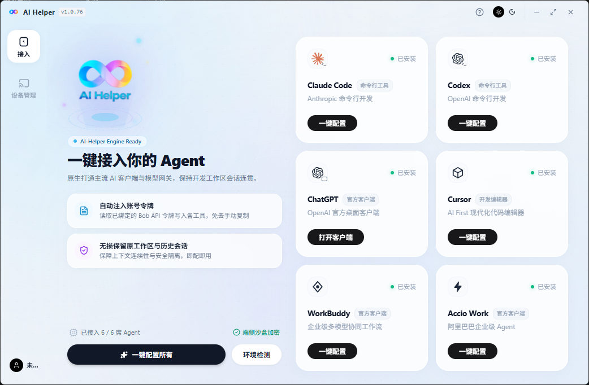
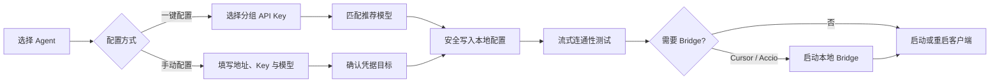

<p align="center">
  
</p>

<h1 align="center">AI Helper — AI Agent 配置管理桌面客户端</h1>

<p align="center">
  在一个桌面应用里管理 Claude Code、OpenAI Codex、ChatGPT、Cursor、WorkBuddy 与 Accio Work。
</p>

<p align="center">
  <a href="https://github.com/TF49/AI-Helper/releases/latest"></a>
  <a href="https://github.com/TF49/AI-Helper/releases"></a>
  <a href="https://tauri.app/"></a>
  <a href="https://www.rust-lang.org/"></a>
  
  
  <a href="./LICENSE"></a>
</p>

<p align="center">
  <a href="https://helper.bob-api.com">🌐 官方网站</a> ·
  <a href="https://github.com/TF49/AI-Helper/releases/latest">📥 下载最新版</a> ·
  <a href="./docs/releases/v1.0.76.md">📋 v1.0.76 更新说明</a> ·
  <a href="https://github.com/TF49/AI-Helper/issues">🐞 问题反馈</a>
</p>

AI Helper 是一款面向 Windows 和 macOS 的开源 AI Agent 配置管理工具。它统一处理 API 地址、API Key、模型、客户端路径、本地 Bridge、连通性测试和应用启动，减少在多个配置文件之间反复切换的工作。

客户端基于 Tauri 2、Rust 和 React 构建。当前版本为 **v1.0.76**，支持 Claude Code、OpenAI Codex CLI、ChatGPT Desktop、Cursor IDE、WorkBuddy 和 Accio Work。

<p align="center">
  
</p>

<p align="center"><sub>AI Helper v1.0.76：Agent 矩阵与一键配置首页</sub></p>

## 目录

- [AI Helper 能做什么](#ai-helper-能做什么)
- [支持的客户端](#支持的客户端)
- [v1.0.76 更新重点](#v1076-更新重点)
- [核心功能](#核心功能)
- [配置与安全](#配置与安全)
- [下载与安装](#下载与安装)
- [快速开始](#快速开始)
- [本地开发](#本地开发)
- [常见问题](#常见问题)

## AI Helper 能做什么

- 🧭 在一个工作台中查看 6 个 Agent 的安装状态，并打开对应配置入口。
- 🔑 将账号中的 API Key 按 Agent 分组写入本地配置，自动匹配推荐模型。
- 🔌 手动配置自定义 API 地址、API Key 和模型，并在保存前完成真实流式连通性测试。
- 🖥️ 自动探测 CLI、桌面客户端和配置文件路径，支持启动、重启与安装包下载。
- 🌉 为 Cursor 和 Accio Work 提供本地协议 Bridge，让不直接支持第三方 OpenAI 兼容接口的客户端使用自定义模型。
- 📊 查看账号额度、令牌分组、通道健康状态和调用记录。
- 🔄 使用多源、签名校验的更新流程获取新版本。

## 支持的客户端

| 客户端              | AI Helper 提供的能力                                                       | 主要配置位置                      |
| ------------------- | -------------------------------------------------------------------------- | --------------------------------- |
| 🟠 Claude Code      | CLI 探测、API 地址与 Auth Token 配置、模型选择、流式测试、启动与重启       | `~/.claude/settings.json`         |
| ⌨️ OpenAI Codex CLI | CLI 探测、API 地址与 API Key 配置、模型选择、流式测试、启动与重启          | `~/.codex/config.toml`            |
| 💬 ChatGPT Desktop  | 安装状态与路径探测、客户端启动、设备管理                                   | 系统安装目录                      |
| 🖱️ Cursor IDE       | 自定义模型配置、Connect-RPC / HTTP2 Bridge、客户端修补与还原、运行状态管理 | `~/.ai-helper/cursor_config.json` |
| 🧩 WorkBuddy        | 多模型维护、推荐模型排序、配置合并、路径兼容与客户端启动                   | `~/.workbuddy/models.json`        |
| ⚡ Accio Work       | 自定义模型配置、本地 Bridge、模型列表注入、协议转译与客户端启动            | `~/.ai-helper/accio_config.json`  |

> WorkBuddy 同时兼容部分历史版本使用的 `~/.workbuddy-ai/models.json`。AI Helper 会识别实际配置位置并保持多模型条目。

## v1.0.76 更新重点

本次更新修复了“一键配置只切换 API Key、却保留旧模型”的问题。现在密钥与模型会按目标 Agent 一起更新，避免新分组中不存在旧模型而返回 `model_not_found`。

| Agent 分组                              | 一键配置使用的推荐模型 |
| --------------------------------------- | ---------------------- |
| Codex / ChatGPT                         | `gpt-5.6-sol`          |
| Claude Code                             | `claude-sonnet-5-5`    |
| WorkBuddy / Accio / Accio Work / Cursor | `glm-5.3`              |

WorkBuddy 的处理方式也做了调整：一键配置会把推荐模型移到列表首位，但不会删除其他手动添加的模型；普通手动保存仍保留原来的更新或追加逻辑。

完整变更与升级说明见 [AI Helper v1.0.76 发布记录](./docs/releases/v1.0.76.md)。

## 核心功能

### Agent 矩阵与一键配置 🎛️

首页按客户端展示安装状态和操作入口。登录后可以选择已有令牌，也可以在缺少可用令牌时创建受管令牌，再按 Codex、Claude 和国内模型三类分组分发到对应 Agent。

一键配置会完成以下工作：

1. 识别目标 Agent 和本地配置位置。
2. 选择或创建适合该分组的 API Key。
3. 写入 API 地址、凭据和推荐模型。
4. 保留不属于 AI Helper 管理范围的配置字段。
5. 刷新界面状态，并在需要时启动本地 Bridge。

### 自定义节点、模型发现与流式测试 🔌

每个配置面板都支持手动选择节点、填写外部 API 地址、读取模型列表和指定模型。连通性测试会发起真实流式请求，并给出 HTTP 状态、首包时间和常见错误的排查提示。

当 API 地址或 API Key 发生变化时，模型缓存会按来源隔离，避免把上一组凭据对应的模型列表带入新配置。

### Cursor 本地 Bridge 🌉

Cursor 使用 Connect-RPC / HTTP2 等内部协议，不能只靠修改一个 OpenAI Base URL 接入所有第三方模型。AI Helper 提供本地 Bridge 和可恢复的客户端修补流程，用于：

- 转换 Cursor 请求与 OpenAI 兼容请求；
- 支持文本、思考内容、图片输入和流式响应；
- 提供可用模型与默认模型信息；
- 检查 Bridge 状态、端口和客户端完整性；
- 备份并还原被修改的客户端文件与本地状态。
- 让 Cursor Agent 在当前工作区读取、搜索和查看图片；修改文件前需要在面板中授权该工作区。

关闭主窗口后，AI Helper 可以留在系统托盘中继续维持 Bridge 运行。

### Accio Work 本地 Bridge 🛠️

Accio Work Bridge 负责模型列表、聊天、图像生成、Responses API 和 MCP 代理等协议的适配。Bridge 包含实例凭据、来源校验、请求限流和请求体大小限制，避免本地端口被无关进程直接调用。

### 设备管理与环境检测 🖥️

设备管理页面集中处理客户端路径和运行状态：

- 自动探测 Claude Code、Codex、ChatGPT、Cursor、WorkBuddy 与 Accio Work；
- 兼容 Windows 常规安装、Microsoft Store 应用和 macOS 常见安装位置；
- 识别 Homebrew、NVM 等环境中的 CLI；
- 启动或重启目标客户端；
- 下载官方安装包并在本地运行安装程序；
- 打开配置文件或在文件管理器中定位文件。

### 账号、分组与用量 📊

登录 Bob API 账号后，可以在客户端内查看：

- 当前余额、累计消耗与额度状态；
- 已创建的 API Key、启用状态、有效期和所属分组；
- 可用通道在 1 小时、3 小时和 6 小时窗口内的成功率、请求数与平均 TTFT；
- 调用日志、模型、令牌、请求时间、消耗和错误信息；
- 分组切换与本地 Agent 同步结果。

### 更新与故障反馈 🔄

更新器会依次检查官网、国内镜像和 GitHub Release，并验证签名、版本序列和文件 SHA-256。更新失败时可以切换来源重试，不需要手动寻找安装包。

客户端内置反馈入口，可附带系统与应用诊断信息，便于定位安装、网络、配置和 Bridge 问题。

## 工作流程



## 配置与安全

AI Helper 会修改本地 Agent 配置，因此写入和凭据流向是项目的重点保护范围。

- 🔐 **系统级凭据保护**：Windows 使用 DPAPI；macOS 和 Linux 使用 Keychain / Secret Service 引用保护会话信息，不在应用目录维护自有明文密钥文件。
- 🛡️ **凭据出口策略**：受管 API Key 只能发送到允许的精确 Origin；外部地址需要用户确认，并默认要求 HTTPS，本地回环地址按 Bridge 场景单独处理。
- 💾 **原子写入与恢复**：配置写入使用文件锁、临时文件替换和备份恢复，降低进程中断或磁盘异常造成配置损坏的风险。
- ♻️ **一键恢复客户端原生配置**：设置页可停止 Cursor / Accio Bridge、恢复 Cursor 补丁，并恢复 Codex、Claude Code 与 WorkBuddy 首次由 AI Helper 修改前的配置快照。旧版本没有快照时，只清理可识别的受管配置；被覆盖的旧值无法推断恢复。快照保存在用户目录下的 `.ai-helper/reset_state.json`，并沿用本地配置文件的访问保护。
- 🧩 **保留用户配置**：Codex、Claude 和 WorkBuddy 采用合并写入，只更新 AI Helper 管理的字段。Cursor 修补提供状态检查、备份和还原。
- 🌉 **本地 Bridge 防护**：Accio Work Bridge 使用实例令牌、Host / Origin 校验、速率限制与载荷上限限制本地代理入口。Cursor Bridge 在每条连接的第一个请求上，根据对端端口找到发起连接的进程，只接受与 AI Helper 属于同一系统用户的进程（Windows 比较进程令牌 SID，Linux 读取 `/proc/net/tcp`，macOS 使用 libproc）；无法确认时一律拒绝，并叠加 Host / Origin 与 Content-Type 校验。
- 📂 **Cursor Agent 工作区授权**：Agent 只把 Cursor 提供的工作区目录作为根，拒绝磁盘根目录、用户主目录本身和 `~/.ai-helper`。读取文件不需要授权；写入、替换、新建目录和删除必须先在 Cursor 面板的「Agent 工作区授权」中允许对应工作区，授权保存在 `~/.ai-helper/agent_workspaces.json`，可随时撤销，一键恢复时一并清除。删除只会移入系统回收站，任何 `.git` 目录都禁止修改。
- ✅ **可信更新**：更新清单和安装包经过签名、SHA-256 与防回滚检查后才会进入安装流程。

建议始终从 [AI Helper 官网](https://helper.bob-api.com) 或 [GitHub Releases](https://github.com/TF49/AI-Helper/releases) 下载客户端，不要运行来源不明的二次打包版本。

## 下载与安装

当前稳定版本：**v1.0.76**（2026-11-05）

| 平台                       | 安装包                  | 官方下载                                                                                                 |
| -------------------------- | ----------------------- | -------------------------------------------------------------------------------------------------------- |
| 🪟 Windows 10 / 11 x64     | 安装版 `Setup.exe`      | [下载 Windows 安装版](https://helper.bob-api.com/downloads/AI-Helper-v1.0.76-Windows-x64-Setup.exe)      |
| 🪟 Windows 10 / 11 x64     | 便携版 `Standalone.zip` | [下载 Windows 便携版](https://helper.bob-api.com/downloads/AI-Helper-v1.0.76-Windows-x64-Standalone.zip) |
| 🍎 macOS 11+ Apple Silicon | `aarch64.dmg`           | [下载 Apple Silicon 版](https://helper.bob-api.com/downloads/AI-Helper-v1.0.76-macOS-aarch64.dmg)        |
| 🍎 macOS 11+ Intel         | `x64.dmg`               | [下载 Intel 版](https://helper.bob-api.com/downloads/AI-Helper-v1.0.76-macOS-x64.dmg)                    |

还可以通过以下入口获取安装包：

- [AI Helper 官方下载页](https://helper.bob-api.com)
- [GitHub Releases 最新版本](https://github.com/TF49/AI-Helper/releases/latest)
- [v1.0.76 GitHub Release](https://github.com/TF49/AI-Helper/releases/tag/v1.0.76)

Windows 版依赖 Microsoft Edge WebView2 Runtime，Windows 11 通常已预装。macOS 当前提供 Apple Silicon 和 Intel 两种独立构建。

## 快速开始

1. 📥 下载并安装适合当前系统架构的 AI Helper。
2. 🔍 启动客户端并完成环境检测，确认需要管理的 Agent 已被识别。
3. 🔑 登录并选择 API Key，或进入具体 Agent 面板手动填写自定义配置。
4. ⚡ 使用“一键配置所有”，或逐个 Agent 保存并执行流式连通性测试。
5. 🚀 Cursor 和 Accio Work 用户按面板提示启动 Bridge；需要时再启动或重启目标客户端。

如果升级前已经使用过一键配置，v1.0.76 建议重新执行一次，让 API Key 与分组推荐模型重新对齐。

## 技术架构

| 层级     | 技术与职责                                                |
| -------- | --------------------------------------------------------- |
| 桌面壳   | Tauri 2，窗口、托盘、更新与系统集成                       |
| 前端     | React 18、TypeScript、Vite、Tailwind CSS、Radix UI        |
| 本地核心 | Rust 2024、Tokio、Reqwest，负责配置、网络、进程与凭据策略 |
| Bridge   | Axum / Tokio，本地协议转译与流式代理                      |
| 配置格式 | TOML、JSON、SQLite 状态库及各客户端原生文件               |

```text
AI-Helper/
├─ src/                  React 客户端与 Agent 配置界面
├─ src-tauri/            Rust 本地核心、Bridge、更新器与系统集成
├─ website/              官网、下载配置与在线诊断页
├─ docs/releases/        版本发布记录
├─ docs/security/        安全审查与修复记录
├─ scripts/              构建、发版、版本同步与校验脚本
└─ README.png            README 客户端截图
```

## 本地开发

### 环境要求

- Node.js 18 或更高版本
- pnpm 9 或更高版本（项目当前锁定 pnpm 10）
- Rust stable 工具链
- Windows：Visual Studio C++ Build Tools 与 WebView2
- macOS：Xcode Command Line Tools

### 启动开发环境

```bash
git clone https://github.com/TF49/AI-Helper.git
cd AI-Helper
pnpm install
pnpm dev
```

仅启动浏览器中的前端调试页面：

```bash
pnpm dev:renderer
```

### 检查与测试

```bash
pnpm typecheck
pnpm test:security
pnpm test:workflows
pnpm lint:rs
cargo test --manifest-path src-tauri/Cargo.toml
```

### 生产构建

```bash
pnpm build
```

正式桌面产物应通过 Tauri CLI 构建。不要把裸 `cargo build --release` 生成的可执行文件当作最终发布包，因为它不会自动完成前端生产资源的构建与嵌入。

## 常见问题

### AI Helper 支持哪些 AI 编程客户端？

当前支持 Claude Code、OpenAI Codex CLI、ChatGPT Desktop、Cursor IDE、WorkBuddy 和 Accio Work。不同客户端的接入深度不同，详见上方[支持的客户端](#支持的客户端)表格。

### 可以使用自定义 API 地址和自己的 API Key 吗？

可以。各 Agent 配置面板支持自定义 API 地址、API Key 和模型。对于非受管地址，AI Helper 会显示目标 Origin 并要求确认，避免密钥被误发到未授权站点。

### 一键配置会覆盖原有配置吗？

AI Helper 只管理与接入相关的字段，并尽量保留其他配置。v1.0.76 会主动更新当前模型，使其与 API Key 分组一致；WorkBuddy 中其他自定义模型不会被删除。重要配置仍建议自行保留备份。

### Cursor 为什么需要本地 Bridge？

Cursor 的部分通信使用 Connect-RPC / HTTP2 和内部消息格式，不是简单修改 OpenAI Base URL 就能完整接入。Bridge 负责请求、模型列表和流式响应之间的协议转换。

### 关闭 AI Helper 后 Bridge 会中断吗？

点击窗口关闭按钮时，AI Helper 可以转入系统托盘继续运行，Cursor 或 Accio Work Bridge 不会因为主窗口隐藏而立即停止。若从托盘彻底退出应用，Bridge 会随进程结束。

### Windows 和 macOS 都能使用吗？

可以。官方提供 Windows x64、macOS Apple Silicon 和 macOS Intel 安装包。客户端路径探测、窗口控制和 CLI 环境识别会按操作系统分别处理。

## English overview 🌍

AI Helper is an open-source, cross-platform desktop configuration manager for AI coding agents. It supports Claude Code, OpenAI Codex CLI, ChatGPT Desktop, Cursor IDE, WorkBuddy, and Accio Work on Windows and macOS.

The app manages API endpoints, API keys, models, local configuration files, application discovery, streaming connection tests, local protocol bridges, process launching, and signed updates. It is built with Tauri 2, Rust, React, and TypeScript.

## 文档、贡献与许可 📚

- [v1.0.76 发布说明](./docs/releases/v1.0.76.md)
- [安全文档](./docs/security/)
- [问题与功能建议](https://github.com/TF49/AI-Helper/issues)
- [版本发布页](https://github.com/TF49/AI-Helper/releases)

欢迎提交 Issue 或 Pull Request。涉及配置写入、凭据处理、Bridge 和更新链路的改动，请同时补充对应测试和升级说明。

AI Helper 使用 [MIT License](./LICENSE) 发布。第三方依赖许可见 [THIRD_PARTY_NOTICES.md](./THIRD_PARTY_NOTICES.md)。
