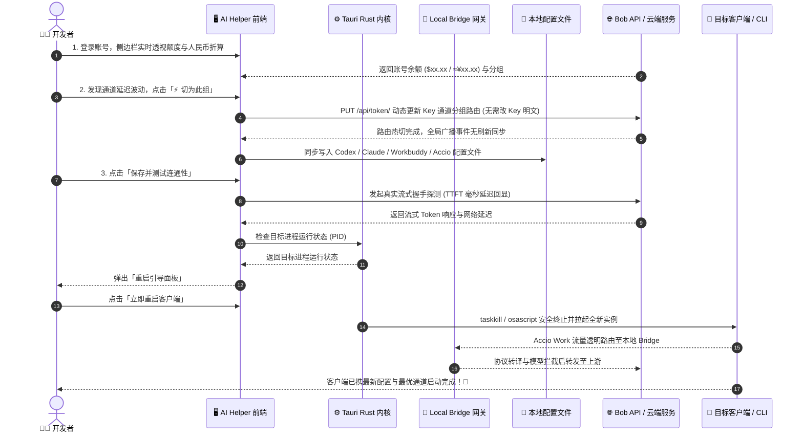

<p align="center">
  
</p>

<h1 align="center">⚡ AI Helper 🚀</h1>

<p align="center">
  <strong>专为 AI 开发者打造的极速 Agent 配置管理中枢、资产遥测大盘 &amp; 协议桥接平台</strong><br>
  <em>The Ultimate Cross-Platform Desktop Hub &amp; Protocol Bridge for Claude Code · OpenAI Codex · WorkBuddy · Accio Work · MCP</em>
</p>

<p align="center">
  <a href="https://github.com/TF49/AI-Helper/releases/latest"></a>
  <a href="https://tauri.app/"></a>
  <a href="https://www.rust-lang.org/"></a>
  <a href="https://react.dev/"></a>
  <a href="https://tailwindcss.com/"></a>
  <a href="https://apple.com/"></a>
  <a href="LICENSE"></a>
  <a href="https://github.com/TF49/AI-Helper/stargazers"></a>
</p>

---

## 💡 为什么需要 AI Helper？

在以 **Claude Code CLI**、**OpenAI Codex CLI**、**ChatGPT 桌面端**、**WorkBuddy AI** 和 **Accio Work** 为代表的下一代 AI 编程时代，开发者经常面临以下痛点：

- 🤯 **配置极度碎片化**：不同 CLI 与客户端的配置文件散落各处（`config.toml`、`settings.json`、`models.json`、`accio_config.json`），格式各异且极易配错。
- ⚡ **通道分组切换成本极高**：过去若想为特定 Agent 更换模型通道或升级至 SVIP 分组，需要在后台翻找 Key、改配置、重启终端，操作繁琐且易打断开发心流。
- 💰 **资产额度感知黑盒**：无法实时洞悉账号余额、已消耗金额、折算人民币汇率与当前分组，往往遇到额度耗尽报错才后知后觉。
- ⏳ **修改后生效繁琐**：每次下发新 API Key 或切换模型节点后，需要手动在终端中查找 PID、强杀进程并手动唤醒新实例。
- 🍎 **跨平台环境割裂**：macOS 与 Windows 的应用路径、环境变量（NVM/Homebrew 多版本 Node）、终端调用及窗口管理各不相同，跨端配置费时费力。
- 🛡️ **网络排错与拦截难辨**：受限网络下遭遇防火墙或 CDN 拦截返回 HTML 时报错晦涩，人机校验存在时序与手势冲突风险。

**AI Helper** 破局而生！🎉 基于 **Tauri v2 (Rust 2024)** 与 **React** 深度打磨，兼具原生级别的极致性能、精美灵动的苹果风设计与工业级稳健性。提供从 **「账号原生登录 ➔ 钱包资产透视 ➔ 零感秒切通道 ➔ 批量凭据分发 ➔ 本地 Bridge 协议转译 ➔ 真实流式测试 ➔ 跨平台进程热重启」** 的全链路闭环体验！⚡

---

## 🌟 核心功能全景 (Key Features)

```
┌────────────────────────────────────────────────────────────────────────────────────────┐
│                         AI Helper v1.0.57 跨平台现代化架构与能力全景                     │
├──────────────────────┬──────────────────────┬──────────────────────┬───────────────────┤
│  🤖 五核 Agent 矩阵  │  💰 账号生态与钱包大盘│  ⚡ 零感秒切通道分组 │  🍎 macOS 原生跨平台 │
│  • OpenAI / Codex    │  • 侧边栏实时余额透视│  • 服务端动态路由热切│  • Apple Silicon M系  │
│  • Claude Code CLI   │  • 美元与人民币折算  │  • 零改 Key 零重启终端│  • Intel x86_64 双架构│
│  • WorkBuddy AI      │  • 历史消耗/无限额度 │  • 四大 Agent 秒级广播│  • 原生红绿灯 Overlay │
│  • Accio Work        │  • 401 自动续期自愈  │  • 候选分组行内修改  │  • NVM / Homebrew 探测│
│  • MCP 协议代理路由  │  • RSA-OAEP + 2FA   │  • 多通道性能 PK 对比│  • AppleScript 原生唤醒│
├──────────────────────┼──────────────────────┼──────────────────────┼───────────────────┤
│  📊 通道智能遥测监控 │  🌉 本地 Bridge 网关 │  🎨 极客美学与交互   │  🛡️ 网络韧性与多源分发│
│  • 1h/3h/6h 成功率   │  • Axum + Tokio 驱动 │  • 苹果风毛玻璃 Dock │  • HTML 拦截熔断防御  │
│  • 平均 TTFT 毫秒延迟│  • 模型路由动态拦截  │  • 侧边栏折叠双模Rail│  • 代理探测 3s 缓存   │
│  • Ribbon/Area/Bar   │  • DALL-E 3 生图转译 │  • Ctrl+B / Cmd+B 键 │  • 穿透探测无缝自愈   │
│  • Agent 专属路由匹配│  • OpenAI Responses  │  • 0 延迟跟手滑块验证│  • 阿里云千兆 OSS 通道│
└──────────────────────┴──────────────────────┴──────────────────────┴───────────────────┘
```

### 1. 🤖 五核主流 Agent 统一管理与跨平台调度
- 🟢 **ChatGPT (Codex CLI / Desktop)**：自动管理 `~/.codex/config.toml`；内置热门模型快捷填充芯片；统一配置官方或第三方 API 网关与 API Key。
- 🟣 **Claude Code CLI**：深度托管 `~/.claude.json` 与 `settings.json`；内置 Claude 3.7 Sonnet、Claude 3.5 Sonnet、Claude 3.5 Haiku、Claude 3 Opus 智能芯片；自动注入中转网关。
- 🟩 **WorkBuddy AI**：深度托管 `models.json`；Emerald 翠绿专属主题；支持模型多配置增删改查、安装路径探测与自定义模型维护。
- 🟠 **Accio Work**：专属橙色主题面板；无缝对接本地 Bridge 网关；支持顶级模型锁定与动态模型元数据列表注入。
- 🧩 **MCP (Model Context Protocol)**：通过本地 Bridge 提供 `/api/mcp/proxy` 显式代理入口，支持标准 JSON-RPC 2.0 错误规范，赋能多 Agent MCP 工具生态。

### 2. 💰 账号额度与钱包全景大盘 (Account Balance & Wallet)
- 💳 **侧边栏常驻额度卡片 (`AccountBalanceCard`)**：
  - **双币种精准折算**：实时显示美元余额 `$wallet.quota_usd`，并基于平台充值标准比率（`1￥ = 4$`）毫秒级自动换算等价人民币 `≈ ¥wallet.quota_cny`。
  - **无限额度智能识别**：特权账号自动识别并优雅呈现「无限额度 ♾️」。
  - **资产消耗透视**：清晰展示历史累计已消耗额度，精准把控模型 Token 消费趋势。
  - **一键直通与旋转刷新**：带物理微动效的一键数据刷新，内置一键跳转官方钱包充值中心外链。
- 🧭 **顶栏便捷钱包入口**：顶部工具栏已登录状态下浮现钱包图标，悬停即可预览资产详情，点击快速唤醒充值。
- 🛡️ **Rust 底层 401 自动续期自愈**：当长期待机导致 Session Token 过期时，底层 `get_user_wallet()` 捕获 401 自动调用 `refresh_session()` 并静默重试，告别登录失效弹窗打扰。
- 🔐 **军工级鉴权体系**：支持 Bob API 原生登录、GO 滑块人机验证挑战、TOTP 2FA 双因素认证，全链路采用 RSA-OAEP WebCrypto 非对称加密传输。

### 3. ⚡ 零感通道分组秒级热切换 (Zero-Friction Switch)
- 🚀 **动态路由毫秒级生效**：通过服务端底层 API 动态重绑定当前 Key 的分组路由规则。**本地 API Key 字符串无需做任何修改，运行中的 CLI 与客户端无需重启**，下一次请求自动路由至目标分组！
- 🎛️ **全场景无死角切流入口**：
  - **指标监控大盘**：在预览卡片上一键点击「⚡ 切为此组」即刻热切换。
  - **分组抽屉全列表**：在展开的分组清单中点击闪电图标极速切换。
  - **多通道横向对比**：在通道性能 PK 弹窗中选定最优低延迟分组并直接应用。
- 🤖 **全局四端协同联动**：支持一键勾选「同时同步至全部 4 大本地 Agent（Codex、Claude、Workbuddy、Accio）」，全套配置文件原子写入。
- 📡 **全局自定义事件总线**：构建 `ai_helper_group_updated` 与 `ai_helper_sync_all_tokens` 事件广播体系，界面内所有卡片、输入框与分组标签无刷新毫秒级响应。
- 🏷️ **API Key 分组行内修改与创建指定**：在 `TokenSelectModal` 中直观查看与修改每个 Key 的关联分组，支持创建 Key 时直接赋予目标分组。

### 4. 🍎 macOS 原生跨平台生态与双架构支持
- 🍏 **Apple Silicon & Intel 双架构原生适配**：
  - 针对 M1/M2/M3/M4 芯片的 `aarch64-apple-darwin` 原生编译，享受零 Rosetta 转译损耗的冷启动与低功耗。
  - 针对 Intel 架构的 `x86_64-apple-darwin` 全面兼顾，全自动 DMG 镜像打包流水线。
- 🚦 **原生红绿灯 Overlay 沉浸式视界**：深度定制 macOS 原生红绿灯标题栏，前端自适应预留 80px 呼吸间距，杜绝重叠；Windows 端保持无边框极简设计。
- 🌊 **原生 Dock 图标生命周期**：接入 macOS `Reopen` 事件，点击 Dock 图标即刻唤醒并置顶窗口，托盘菜单支持左键即开。
- ⌨️ **跨平台原生修饰键与全局快捷键**：自动适配 Mac 的 `⌘+B` 与 Windows 的 `Ctrl+B`，智能识别输入框焦点防止打字冲突。
- 🔍 **macOS 级全环境深度探测**：
  - 覆盖 `/opt/homebrew/bin` 与 `/usr/local/bin`。
  - 智能扫描 `~/.nvm/versions/node` 并**倒序优选最新 Node 版本**，终结因 NVM 隔离导致 CLI 无法识别的痛点。
  - 通过 AppleScript 唤起 Mac 原生 Terminal.app 开启独立 Tab 执行 CLI，Accio 启动时自动注入本地 Bridge 环境变量。

### 5. 📊 通道分组智能遥测与健康稳定性监控
- ⏱️ **全周期可用率与时延雷达**：集成遥测接口，自动汇总各分组在近 **1 小时 / 3 小时 / 6 小时** 内的调用成功率、平均 TTFT 毫秒时延、累计请求数与异常数，90 秒后台自动静默轮询。
- 📈 **三大专业遥测图表 (HealthTrendVisualizer)**：
  - 🟩 **连续分段健康条 (Ribbon)**：GitHub Status / Cloudflare 风格 5 分钟时间桶状态展示，悬浮毫秒级呈现桶内明细。
  - 🌊 **平滑贝塞尔波形曲线 (Area)**：通透渐变波形动画，直观反映网络抖动与波峰波谷。
  - 📊 **宽幅时间遥测柱 (Bar)**：高密度时间分布柱状图，直观感知流量冲击与熔断状态。
- 🎯 **四大 Agent 专属通道路由推荐**：
  - **OpenAI / Codex CLI**：智能匹配 `codex`、`svip-codex` 专属通道，保障高并发代码流式输出。
  - **Claude Code CLI**：推荐匹配 `claude`、`kiro` 专属分组，支持 Extended Thinking 深度思考链与 Prompt Caching，杜绝 400/404 报错。
  - **WorkBuddy AI**：推荐全模型聚合通道，确保 DeepSeek、Claude、GPT-4o 覆盖全面。
  - **Accio Work**：推荐稳定低延迟长文本通道，保障复杂工作流不中断。
- 📁 **配置文件路径原生直达 (ConfigPathBar)**：各面板统一嵌入配置路径栏，支持一键复制路径，并在默认编辑器或文件管理器中秒级打开配置文件。

### 6. 🌉 Accio Local Bridge 协议网关 (Local Protocol Bridge)
- 🦀 **原生 Axum + Tokio 高性能架构**：超轻量内存占用，常驻低开销。
- 🎯 **模型路由动态拦截**：精准拦截 Accio 内部模型决策请求，强制锁定至自定义顶级模型（Claude 3.7、GPT-4o、DeepSeek R1 等）。
- 📋 **原生模型列表伪造注入**：向客户端注入自定义模型完整元数据，原生下拉框完美识别与切换。
- 🎨 **DALL-E 3 生图协议转译**：自动拦截 Accio 生图请求并重定向至 OpenAI `/v1/images/generations`，自适应映射尺寸，Base64/URL 双路兼容回传。
- 🔄 **OpenAI Responses API 对齐**：完整支持 `/v1/responses` 协议，`messages → input`、`max_tokens → max_output_tokens`，Tool Call 全链路解析与 Function Calling 多格式容错自愈。
- 🧩 **MCP 显式代理路由**：`/api/mcp/proxy` 入口，标准 JSON-RPC 2.0 规范。
- 🗜️ **安全压缩解码与资源保护**：支持 gzip / Brotli / deflate 请求体解码，内置 64 MB 解压上限与 128 MB 响应上限双重保护。

### 7. 🎨 苹果风悬浮 Dock 与极客交互美学
- 🍎 **全配置面板苹果风悬浮 Dock 栏**：
  - 告别底部贴边直角分割，升级为 `rounded-2xl` 悬浮药丸形态。
  - 搭载 `backdrop-blur-xl` + `backdrop-saturate-150` 超透双滤镜与顶部 1px 内嵌微高光。
  - 统一集成「分步向导（Step Wizard）」与「概览配置（Summary）」模式自由切换。
- 🗂️ **侧边栏折叠双模架构**：
  - 支持 **完整展开模式 (256px)** 与 **紧凑图标轨模式 (68px Rail)** 毫秒级切换，释放近 200px 主工作台横向视野。
  - 支持 `Ctrl+B` / `Cmd+B` 全局快捷键与输入焦点智能保护，状态持久化于本地。
- 📂 **模块化手风琴折叠分组**：配置目标组 (Targets) 与辅助工具组 (Tools) 独立折叠，界面清爽井井有条。
- 🧩 **高敏滑块人机验证器**：
  - **Ref + State 双轨持锁**：彻底根除滑块通过后闭包偶发未触发自动登录的时序隐患。
  - **拖拽 0 延迟物理跟手**：动态剥离拖拽过程中的过渡动画，松手平滑回弹。
  - **Pointer Capture 异常安全沙盒**：消灭控制台告警，`touch-none` 防手势冲突。

### 8. 🛡️ 网络韧性防御与全网高速多源分发
- 🛑 **HTML 拦截熔断智能识别**：自动识别企业防火墙、校园网认证或 CDN 挑战返回的 HTML 页面，抛出精准的 TUN 虚拟网卡模式与代理开启指引。
- ⚡ **代理探测 3 秒 TTL 轻量缓存**：杜绝高频请求下的重复 TCP 端口握手探测，降低资源开销。
- 🛡️ **更新器多源穿透探测加固 (`try_check!`)**：重构多源检测流水线，彻底消除自建镜像站 cron 轮询导致的“发版检测盲区”，第一时间秒级感知 GitHub Release。
- 🚀 **全网高速下载通道矩阵**：
  - **阿里云 OSS 专属千兆高速镜像**：国内骨干节点直连不限速。
  - **官方自建站直链**：免代理秒级下载。
  - **国内加速镜像 (ghfast)**：多重备用容灾。
  - **GitHub Releases 官方源**：全球统一同步。

---

## 🔄 核心工作流程 (Workflow)



---

## 📦 下载与安装 (Downloads)

前往 [官网下载中心](https://helper.bob-api.com) 或 [GitHub Releases](https://github.com/TF49/AI-Helper/releases/latest) 下载最新发布的安装包：

### 🪟 Windows (Windows 10 / 11 64位)

| 安装包类型 | 下载通道 | 说明 |
| :--- | :--- | :--- |
| **🚀 标准安装版 (Setup.exe)** | [阿里云 OSS 千兆通道](https://bobdong.oss-cn-beijing.aliyuncs.com/desktop/AI-Helper-v1.0.57-Windows-x64-Setup.exe) · [本站直链](https://helper.bob-api.com/downloads/AI-Helper-v1.0.57-Windows-x64-Setup.exe) · [国内镜像](https://ghfast.top/https://github.com/TF49/AI-Helper/releases/download/v1.0.57/AI-Helper-v1.0.57-Windows-x64-Setup.exe) | 推荐使用！含桌面快捷方式、静默自动更新与运行库检测 |
| **💼 绿色便携版 (Standalone.zip)** | [官方直链下载](https://helper.bob-api.com/downloads/AI-Helper-v1.0.57-Windows-x64-Standalone.zip) · [国内加速镜像](https://ghfast.top/https://github.com/TF49/AI-Helper/releases/download/v1.0.57/AI-Helper-v1.0.57-Windows-x64-Standalone.zip) | 解压即用，无须安装，不污染注册表，适合企业内网环境 |

> 📌 **Windows 环境要求**：系统需预装 [Microsoft Edge WebView2 Runtime](https://developer.microsoft.com/microsoft-edge/webview2/)（Win11 自带）。

### 🍏 macOS (macOS 11.0 Big Sur 及以上)

| 架构类型 | 下载文件 | 说明 |
| :--- | :--- | :--- |
| **🍎 Apple Silicon (推荐)** | `AI-Helper-v1.0.57-macOS-aarch64.dmg` | 专为 M1 / M2 / M3 / M4 芯片深度原生编译，超低功耗零转译 |
| **💻 Intel 架构** | `AI-Helper-v1.0.57-macOS-x64.dmg` | 兼容所有 Intel 架构 Mac 电脑，体验一致 |

---

## 🛠️ 本地开发与构建 (Development)

如果你希望在本地编译调试或为 AI Helper 贡献代码，请参考以下指南：

### 1. 环境准备
- [Node.js](https://nodejs.org/) (>= 18.0.0) & [pnpm](https://pnpm.io/) (>= 9.0)
- [Rust](https://www.rust-lang.org/) (推荐安装最新 stable 工具链与 `cargo`)
- **Windows**: Visual Studio C++ Build Tools (包含 Windows 10/11 SDK)
- **macOS**: Xcode Command Line Tools (`xcode-select --install`)

### 2. 克隆项目与安装依赖
```bash
# 克隆代码仓库
git clone https://github.com/TF49/AI-Helper.git
cd AI-Helper

# 使用 pnpm 安装前端依赖
pnpm install
```

### 3. 启动本地桌面调试
```bash
# 启动 Tauri 桌面端热重载开发环境
pnpm dev

# 仅启动前端 Vite 预览 (内置完整离线 Mock 鉴权数据)
pnpm dev:renderer
```

### 4. 生产环境打包构建
```bash
# 自动编译 Rust 后端与 Vite 前端并打包为生产安装包
pnpm build

# macOS 环境专属打包封装 DMG 映像
bash scripts/package-macos.sh
```
打包生成的可执行程序与安装包将位于：`src-tauri/target/release/bundle/`。

---

## 📁 核心项目结构 (Project Structure)

```
AI-Helper/
├── 📁 .github/              # GitHub Actions CI/CD 多平台矩阵自动发布工作流
├── 📁 docs/                 # 项目架构文档与历代完整 Release Notes (v1.0.0 ~ v1.0.57)
├── 📁 public/               # 静态资源、品牌 Logo 图形与 Favicon
├── 📁 scripts/              # 自动化发版与运维脚本 (bump-version, sync-website, sync-mirror 等)
├── 📁 src/                  # React + TypeScript 前端工作区
│   ├── 📁 components/       # 核心 UI 面板与交互组件
│   │   ├── 💳 AccountBalanceCard.tsx   # 账号额度大盘与汇率双币种折算卡片
│   │   ├── 📊 ChannelGroupMonitor.tsx  # 通道分组健康遥测、零感秒切与智能选组中枢
│   │   ├── 📈 HealthTrendVisualizer.tsx # Ribbon分段条 / Area波形 / Bar柱状 遥测可视化
│   │   ├── 📁 auth/                    # 账号登录、滑块验证 (SlideCaptcha) 与令牌分发抽屉
│   │   ├── 📄 ApiKeyInput.tsx          # 令牌输入框组件 (带云端分组校验与全局事件总线)
│   │   ├── 📄 ConfigPathBar.tsx        # 配置文件路径一键复制与原生调阅组件
│   │   ├── 📄 ChatGPTPanel.tsx         # OpenAI / Codex 配置面板 (苹果风悬浮 Dock)
│   │   ├── 📄 ClaudePanel.tsx          # Claude Code CLI 托管面板 (苹果风悬浮 Dock)
│   │   ├── 📄 WorkbuddyPanel.tsx       # WorkBuddy AI 模型管理面板 (苹果风悬浮 Dock)
│   │   ├── 📄 AccioWorkPanel.tsx       # Accio Work 本地 Bridge 托管面板 (苹果风悬浮 Dock)
│   │   └── 📄 AppPathsPanel.tsx        # 应用与 CLI 路径深度探测与配置面板
│   ├── 📁 lib/              # API 请求、Tauri IPC 封装、平台环境与跨平台辅助库
│   │   ├── 📄 platform.ts   # 跨平台环境与专属修饰键 (Ctrl / ⌘) 检测
│   │   └── 📄 api.ts        # 全栈鉴权 API 与离线 Mock 数据矩阵
│   ├── 📄 App.tsx           # 桌面主窗口、双模侧边栏 (Rail/Full)、手风琴分组与全局容器
│   └── 📄 main.tsx          # 前端主入口
├── 📁 src-tauri/            # Tauri + Rust 桌面后端
│   ├── 📁 icons/            # 全平台全尺寸专属 App 图标库 (Windows .ico / macOS .icns)
│   ├── 📁 src/
│   │   ├── 📁 accio/        # Accio Local Bridge 网关 (bridge.rs, config.rs, protocol.rs)
│   │   ├── 📄 auth.rs       # 账号认证、钱包额度 (get_user_wallet)、401续期、通道分组与HTML防御
│   │   ├── 📄 app_paths.rs  # 全平台应用与 CLI 路径探测引擎 (NVM / Homebrew / Win32)
│   │   ├── 📄 process_manager.rs # 跨平台进程树安全熔断、热重启与 AppleScript 终端拉起
│   │   ├── 📄 updater.rs    # 自动更新多源穿透探测加固 (try_check! 宏) 与代理 3s 缓存
│   │   └── 📄 network.rs    # 网络心跳探针与超时诊断
│   ├── 📄 Cargo.toml        # Rust 依赖声明 (Rust 2024 Edition)
│   └── 📄 tauri.conf.json   # Tauri 应用主配置 (Overlay 红绿灯、窗口布局)
├── 📁 website/              # 官网落地页 (纯静态，动态读取 download-config.json)
└── 📄 package.json          # Node 依赖与脚本配置
```

---

## 🗺️ 演进路线 (Roadmap)

- [x] **v1.0.14**: 品牌焕新重塑为 AI Helper，推出现代桌面双栏工作台与热门模型芯片。
- [x] **v1.0.20**: 推出全新应用/CLI 路径管理面板、单快照高并发进程扫描与智能平滑热重启闭环。
- [x] **v1.0.25**: 正式接入 WorkBuddy AI 成为第三大 Agent，深度安全加固与全栈工程规范升级。
- [x] **v1.0.30**: 推出 Accio Work 支持，内置 Rust Axum + Tokio 本地 Bridge 协议网关，实现模型路由拦截与自定义模型列表注入。
- [x] **v1.0.36**: 原生接入 bob-api.com 账号体系，RSA-OAEP 加密、2FA 双因素认证、一键批量分发 API Key。
- [x] **v1.0.43**: 完整切换至 OpenAI Responses API (`/v1/responses`) 协议，修复 Tool 参数类型安全问题。
- [x] **v1.0.49**: 推出通道分组智能检测与健康稳定性监控（Channel Group Monitor），支持 1h/3h/6h 遥测时段切换与三大可视化图表。
- [x] **v1.0.50**: 四大面板底部导航统一重构，系统托盘后台守护常驻，自托管更新源加速直连。
- [x] **v1.0.51**: 全配置面板升级「苹果风毛玻璃悬浮 Dock 栏」，侧边栏层级架构精简降维。
- [x] **v1.0.52**: 自动更新多源穿透探测加固（`try_check!` 宏），彻底消除镜像站同步导致的 10 分钟发版检测盲区。
- [x] **v1.0.53**: 全面接入阿里云 OSS 千兆高速下载通道，官网全自动化版本流转引擎上线。
- [x] **v1.0.54**: 登录鉴权 Ref + State 双轨持锁闭环，滑块人机验证高敏体验重塑，离线全栈 Mock 矩阵。
- [x] **v1.0.55**: 侧边栏折叠双模架构（紧凑 Rail / 展开）与 `Ctrl+B` / `Cmd+B` 极客快捷键，手风琴分组展开持久化，滑块 0 延迟跟手。
- [x] **v1.0.56**: macOS 全生态原生支持（Apple Silicon 与 Intel 双架构 DMG），原生红绿灯 Overlay 沉浸视界，NVM/Homebrew 智能探测，HTML 拦截熔断防御与代理 3 秒 TTL 缓存。
- [x] **v1.0.57**: 账号额度与钱包全景大盘上线（美元/人民币双币实时折算），401 会话凭据透明重试自愈，首创「零感通道分组秒级热切换」，全局四大 Agent 秒级联动广播。
- [ ] **v1.1.0** *(Planned)*: 支持更多新兴 AI 编程工具与 Agent 扩展（如 Cursor、Windsurf、Roo Code 等配置文件统一托管）。
- [ ] **v1.2.0** *(Planned)*: 支持多套环境配置档案（Profiles）一键快照保存、导入导出与秒级无缝切换。
- [ ] **v1.3.0** *(Planned)*: Linux 桌面发行版（AppImage / Flatpak / deb）原生构建适配。

---

## 🤝 贡献代码 (Contributing)

我们非常欢迎社区开发者提交 Issue 或 Pull Request！

1. Fork 本项目到你的 GitHub 仓库；
2. 新建你的特性分支：`git checkout -b feat/my-amazing-feature`；
3. 提交你的修改并保持良好的 Commit 规范：`git commit -m 'feat: add amazing new feature'`；
4. 推送分支到你的远程仓库：`git push origin feat/my-amazing-feature`；
5. 在 GitHub 提出一个清晰详尽的 Pull Request！🎉

---

## 📄 开源许可证 (License)

本项目遵循 [MIT License](LICENSE) 开源协议。无论是个人学习、自由开发还是商业使用均完全自由开源。

---

<p align="center">
  Made with ❤️ by <strong>TF49 &amp; Open Source Community</strong><br>
  <em>One Helper to Bridge Them All: OpenAI Codex 🤖 · Claude Code 🧠 · WorkBuddy ⚙️ · Accio Work 🚀 · MCP 🧩</em>
</p>
