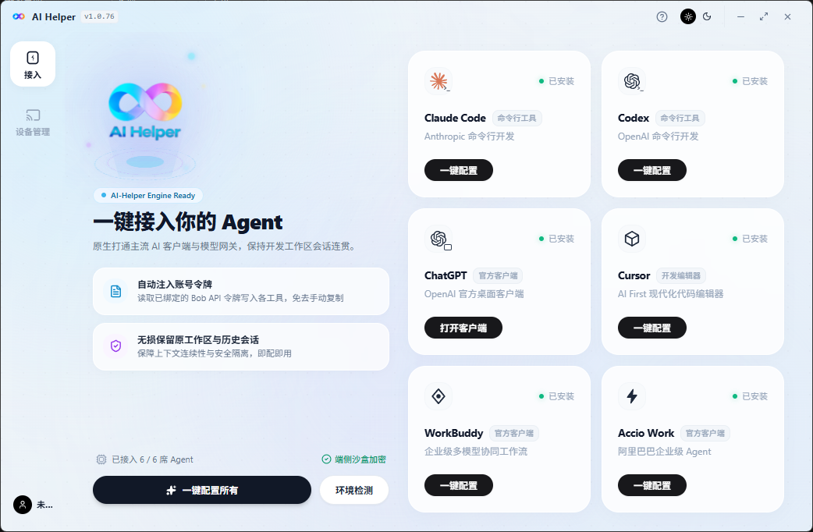

English | [简体中文](./README_ZH.md)

  

<h1 align="center">Bob AI Helper</h1>

  <b>Open-source desktop config manager and local bridge for AI coding clients.</b> 
  One-click Bob API endpoint, key and model setup for Cursor, Claude Code, OpenAI Codex CLI, ChatGPT Desktop, WorkBuddy, Accio Work and DeepSeek Harness.

  
  
  
  
  

  <a href="https://github.com/TF49/AI-Helper/releases/latest">Download</a> ·
  <a href="https://helper.bob-api.com/en/">Website</a> ·
  <a href="https://helper.bob-api.com/en/guides/">Guides</a> ·
  <a href="./docs/releases/">Changelog</a> ·
  <a href="https://github.com/TF49/AI-Helper/issues">Issues</a>

**Bob AI Helper** (shown in the app as "AI Helper") is a free, MIT-licensed desktop app for Windows and macOS that sets the API endpoint, API key and model for your AI coding clients from one place. It detects installed clients, runs a real streaming connection test, writes their local config files once it passes, and launches or restarts the client. Cursor and Accio Work reach third-party models through a built-in local bridge; DeepSeek Harness gets one API key split across Claude, GPT and Chinese-model routes by protocol.

- **Current version:** <!--ver-->v1.0.88<!--/ver--> (<!--date-->2026-11-22<!--/date-->)
- **Platforms:** Windows 10/11 x64 (requires Microsoft Edge WebView2 Runtime); macOS 11+ on Apple Silicon and Intel
- **License:** MIT. The app is free; model usage is billed by Bob API.
- **Built with:** Tauri 2, Rust, React, TypeScript

> Not to be confused with the Discourse "AI Helper" plugin or browser extensions of the same name. Bob AI Helper is the desktop configuration tool published at [helper.bob-api.com](https://helper.bob-api.com) and [github.com/TF49/AI-Helper](https://github.com/TF49/AI-Helper).

  

## Supported clients

| Client | What AI Helper does | Config location |
| --- | --- | --- |
| Claude Code | Detects the CLI; sets `ANTHROPIC_BASE_URL`, `ANTHROPIC_AUTH_TOKEN`, `ANTHROPIC_MODEL`; streaming test; launch/restart | `~/.claude/settings.json` (`env` block) |
| OpenAI Codex CLI | Detects the CLI; sets a custom `model_provider` base URL, API key and model; streaming test; launch/restart | `~/.codex/config.toml` |
| Cursor | Custom models via a local Connect-RPC / HTTP2 bridge (default `127.0.0.1:8969`); reversible client patch | `~/.ai-helper/cursor_config.json` |
| WorkBuddy | Maintains multiple models, puts the recommended model first, keeps user-added models | `~/.workbuddy/models.json` |
| Accio Work | Custom models via a local bridge (default `127.0.0.1:8787`); model list injection | `~/.ai-helper/accio_config.json` |
| DeepSeek Harness (desktop) | Fetches every chat model of a key and writes it by protocol to `aihelper-claude` (Anthropic Messages), `aihelper-codex` (OpenAI Responses) or `aihelper-cn` (Chat Completions); multiple keys side by side; launch/restart | `~/.dsh/profiles/desktop/cordis.patch.yml` and `.credentials.yaml` (`DSH_HOME` overrides `~/.dsh`) |
| ChatGPT Desktop | Install detection, launch, device management (no API configuration) | System install directory |

## Manual setup vs AI Helper

| Task | By hand | With AI Helper |
| --- | --- | --- |
| Point Claude Code at a custom endpoint | Edit the `env` block of `~/.claude/settings.json` and keep the JSON valid | Merges the three `ANTHROPIC_*` fields and leaves other settings untouched |
| Add a custom provider to Codex CLI | Write `[model_providers.custom]`, set `model_provider`, export the key variable | Writes the provider, model and key for you |
| Use a third-party model in Cursor | Overriding the OpenAI base URL does not reach every model, because Cursor talks Connect-RPC / HTTP2 | Local bridge translates the protocol; the client patch can be reverted |
| Route DeepSeek Harness to Claude, GPT and Chinese models | Hand-edit YAML under `~/.dsh`, one route per protocol | Splits a key's models into three managed routes; your own routes are kept |
| Find the right model ID | Look it up in the provider's docs | Fetches the model list from the endpoint |
| Check that it works | Restart the client and read its error | Real streaming request with HTTP status, time to first byte and troubleshooting hints |
| Change keys across several clients | Repeat each edit per client | One panel per client, or one-click setup for all of them |
| Undo | Keep your own backups | Snapshot before the first change; restore from Settings |

## Download

Current release: **<!--ver-->v1.0.88<!--/ver-->**

| Platform | Package | Official mirror | GitHub |
| --- | --- | --- | --- |
| Windows 10/11 x64 | Installer `Setup.exe` | [Download](https://helper.bob-api.com/downloads/AI-Helper-v1.0.88-Windows-x64-Setup.exe) | [Download](https://github.com/TF49/AI-Helper/releases/download/v1.0.88/AI-Helper-v1.0.88-Windows-x64-Setup.exe) |
| Windows 10/11 x64 | Portable `Standalone.zip` | [Download](https://helper.bob-api.com/downloads/AI-Helper-v1.0.88-Windows-x64-Standalone.zip) | [Download](https://github.com/TF49/AI-Helper/releases/download/v1.0.88/AI-Helper-v1.0.88-Windows-x64-Standalone.zip) |
| macOS 11+ Apple Silicon | `aarch64.dmg` | [Download](https://helper.bob-api.com/downloads/AI-Helper-v1.0.88-macOS-aarch64.dmg) | [Download](https://github.com/TF49/AI-Helper/releases/download/v1.0.88/AI-Helper-v1.0.88-macOS-aarch64.dmg) |
| macOS 11+ Intel | `x64.dmg` | [Download](https://helper.bob-api.com/downloads/AI-Helper-v1.0.88-macOS-x64.dmg) | [Download](https://github.com/TF49/AI-Helper/releases/download/v1.0.88/AI-Helper-v1.0.88-macOS-x64.dmg) |

All versions are on [GitHub Releases](https://github.com/TF49/AI-Helper/releases). Only download from the official site or GitHub Releases.

- Windows needs the Microsoft Edge WebView2 Runtime (preinstalled on most Windows 11 systems).
- If macOS says the app "is damaged and can't be opened", run `xattr -cr /Applications/AI\ Helper.app`, or right-click the app in Finder and choose **Open**.

## Quick start

1. Download and install the build for your OS and CPU architecture.
2. Launch AI Helper and let it detect installed clients.
3. Open a client panel and enter an API base URL, an API key and a model. Or sign in with a Bob API account and use one-click setup.
4. Run the streaming connection test. Save once it passes; on failure your existing config is left as is.
5. For Cursor and Accio Work, start the local bridge as the panel prompts. Then launch or restart the client.

## Key features

- **Built-in Bob API nodes.** Every panel lets you choose the BobAPI official node (`https://bob-api.com`) or the TaijiAI accelerated node (backup line), enter an API key and pick a model, and can fetch the model list from the node. Manual setup needs no sign-in.
- **One-click setup** (requires a Bob API account). Picks or creates an API key in the matching key group for each client and writes a recommended model together with it, so you never end up with a new key and a stale model (`model_not_found`).
- **Real streaming test.** Picks the Messages, Responses or Chat Completions protocol per model and reports HTTP status, time to first byte and hints for common errors.
- **Cursor bridge.** Translates between Cursor and OpenAI Chat Completions / Responses or Anthropic Messages. Supports text, image input, streaming, reasoning summaries and Claude tool calls. Cursor Agent can read and search workspace files; writes require per-workspace approval.
- **Accio Work bridge.** Model list, chat, image generation, Responses API and MCP proxying, with an instance token, origin checks, rate limiting and payload limits.
- **Client detection and launch.** Finds Windows, Microsoft Store and macOS installs plus Homebrew / NVM CLIs; launches, restarts and opens config files.
- **Account and usage** (with a Bob API account). Balance, keys and groups, per-channel success rate and TTFT, call logs.
- **Tray mode.** Closing the window keeps AI Helper and its bridges running in the system tray.
- **Verified updates.** Checks the official site, a China mirror and GitHub Releases, and verifies signatures, SHA-256 and version order before installing.

## Security & config

- **OS credential storage.** Session data and cached keys are protected with DPAPI on Windows and the Keychain on macOS. No plaintext key file of its own is kept in the app directory.
- **Key egress policy.** HTTPS only. Keys taken from a signed-in Bob API account can only be sent to Bob API domains, and requests never follow redirects with credentials attached.
- **Safe writes.** File locks, atomic temp-file replacement and backups.
- **Your settings are kept.** Claude Code, Codex and WorkBuddy configs are merged, changing only endpoint, key and model fields. For DeepSeek Harness only `aihelper-*` routes and `AIHELPER_*` key refs are managed in the `desktop` profile; your routes, `records`, comments, `!!js` tags and the official DeepSeek account and API-key routes are preserved.
- **One-click restore.** Settings can stop the bridges, revert the Cursor patch and restore Codex, Claude Code, WorkBuddy and DeepSeek Harness to the snapshot taken before AI Helper's first change (`~/.ai-helper/reset_state.json`).
- **Bridge hardening.** The Cursor bridge only accepts connections from processes owned by the same OS user and rejects anything it cannot verify, on top of Host / Origin and Content-Type checks.
- **Encrypted telemetry.** Diagnostics and crash reports go to `https://monitor.bob-api.com` over HTTPS.

Security reviews are in [docs/security](./docs/security/). To report a vulnerability, see [SECURITY.md](./SECURITY.md).

## FAQ

**Is AI Helper free?**
Yes. The app is MIT-licensed and free. Model usage is billed by Bob API.

**Which API endpoints can I use?**
AI Helper is built for the Bob API service. Each panel offers the BobAPI official node and the TaijiAI accelerated node (backup line); you paste an API key or sign in for one-click setup. Account keys and one-click setup only work with the BobAPI official node; a hand-entered key must be confirmed once per node (确认用于此节点). It does not provide a field for other API providers.

**Is my API key uploaded anywhere?**
No. Keys are written only to local config files and sent only to the BobAPI node you select.

**How do I use glm-5.3 or another third-party model in Cursor?**
Enter the endpoint, key and model in the Cursor panel, pass the test and save; this starts the local bridge (default `127.0.0.1:8969`). Then click **Connect AI Helper** (接入 AI Helper) to patch Cursor, restart Cursor and pick your model from the list. See the [Cursor guide](https://helper.bob-api.com/en/guides/cursor-custom-model.html).

**Will it overwrite my existing settings?**
Only endpoint, key and model fields are changed. A snapshot is taken before the first change and can be restored from Settings. Other WorkBuddy models are not removed.

More questions: Cursor bridge, Claude Code, Codex CLI, DeepSeek Harness, tray mode

**Why does Cursor need a local bridge?**
Cursor uses Connect-RPC / HTTP2 and internal message formats, so changing an OpenAI base URL alone cannot connect every third-party model. The bridge translates requests, model lists and streaming responses.

**How do I switch Claude Code to another endpoint and model?**
Claude Code reads `ANTHROPIC_BASE_URL`, `ANTHROPIC_AUTH_TOKEN` and `ANTHROPIC_MODEL` from the `env` block of `~/.claude/settings.json`. AI Helper merges those three fields and keeps everything else. See the [Claude Code guide](https://helper.bob-api.com/en/guides/claude-code-custom-api.html).

**How do I set a custom endpoint for Codex CLI?**
Codex reads `[model_providers.custom]` (`base_url` and `env_key`) from `~/.codex/config.toml`, with the top-level `model_provider` pointing at it. AI Helper writes these fields and stores the key in the `CUSTOM_OPENAI_API_KEY` variable. See the [Codex CLI guide](https://helper.bob-api.com/en/guides/codex-cli-custom-api.html).

**Does configuring DeepSeek Harness affect my official DeepSeek account?**
No. Only `aihelper-*` routes and `AIHELPER_*` key refs in the desktop profile are managed; the official account login, official API-key routes (`api.deepseek.com`) and your own routes are kept. Launch DeepSeek Harness once to initialize it before configuring, then restart it to see the new routes. See the [DeepSeek Harness guide](https://helper.bob-api.com/en/guides/deepseek-harness-custom-api.html).

**Does the bridge stop when I close AI Helper?**
Closing the window sends AI Helper to the system tray and the bridge keeps running. Quitting from the tray stops it.

**What is a "key group"?**
A group (分组) is the name used to organize API keys inside a Bob API account, not a model name. It only matters for one-click setup; for manual setup you paste a key yourself. See the [about page](https://helper.bob-api.com/about.html#groups).

## Guides

- English: [helper.bob-api.com/en/guides](https://helper.bob-api.com/en/guides/)
- Chinese: [helper.bob-api.com/guides](https://helper.bob-api.com/guides/) — Cursor custom models, Claude Code custom API, Codex CLI custom provider, DeepSeek Harness routes, macOS "app is damaged" fix

## Recent updates

| Version | Date | Highlights |
| --- | --- | --- |
| [v1.0.88](./docs/releases/v1.0.88.md) | 2026-11-22 | WorkBuddy default context (`maxInputTokens`) raised from 32K to 256K; one-click setup writes it explicitly |
| [v1.0.87](./docs/releases/v1.0.87.md) | 2026-11-21 | DeepSeek Harness support: one key split into three routes by protocol, multiple keys side by side, lossless YAML writes |
| [v1.0.86](./docs/releases/v1.0.86.md) | 2026-11-20 | Telemetry moved to `monitor.bob-api.com`, HTTPS end to end |

Release notes are in Chinese. Full history: [docs/releases](./docs/releases/) and [GitHub Releases](https://github.com/TF49/AI-Helper/releases).

## Contributing & license

Issues and pull requests are welcome.

- [Contributing guide](./CONTRIBUTING.md) · [Security policy](./SECURITY.md) · [Code of conduct](./CODE_OF_CONDUCT.md)
- Local development setup: see [CONTRIBUTING.md](./CONTRIBUTING.md) or the folded section in [README_ZH.md](./README_ZH.md#本地开发)

Released under the [MIT License](./LICENSE). Third-party licenses: [THIRD_PARTY_NOTICES.md](./THIRD_PARTY_NOTICES.md).

## Links

- Website: [helper.bob-api.com](https://helper.bob-api.com) · [English overview](https://helper.bob-api.com/en/)
- Machine-readable summary: [helper.bob-api.com/llms.txt](https://helper.bob-api.com/llms.txt)
- About, maintainer and glossary: [helper.bob-api.com/about.html](https://helper.bob-api.com/about.html)
