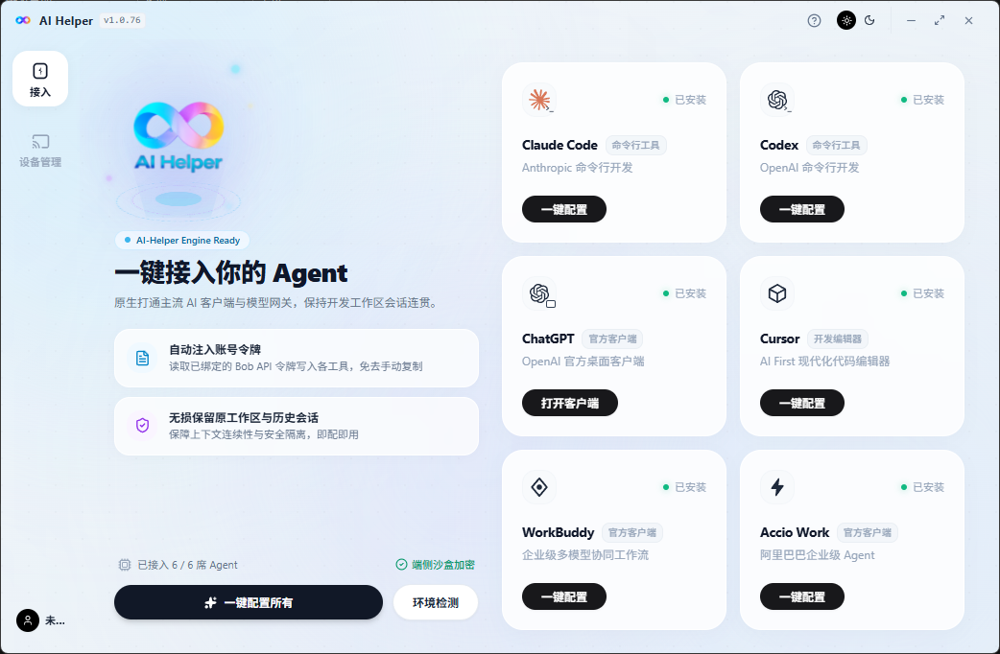
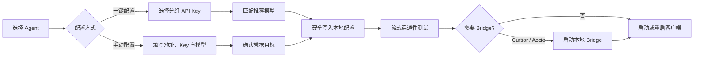

[English](./README.md) | 简体中文

<p align="center">
  
</p>

<h1 align="center">Bob AI Helper — 一键配置 Cursor、Claude Code、Codex 的 API 地址、Key 与模型</h1>

<p align="center">
  开源免费的 AI 编程客户端配置管理工具 · Windows / macOS
</p>

<p align="center">
  <a href="https://github.com/TF49/AI-Helper/releases/latest"></a>
  <a href="https://github.com/TF49/AI-Helper/releases"></a>
  <a href="https://tauri.app/"></a>
  <a href="https://www.rust-lang.org/"></a>
  
  
  <a href="./LICENSE"></a>
</p>

<p align="center">
  <a href="https://helper.bob-api.com">🌐 官方网站</a> ·
  <a href="https://helper.bob-api.com/guides/">📖 使用教程</a> ·
  <a href="./README.md">🇬🇧 English</a> ·
  <a href="https://github.com/TF49/AI-Helper/releases/latest">📥 下载最新版</a> ·
  <a href="./docs/releases/">📋 更新日志</a> ·
  <a href="https://github.com/TF49/AI-Helper/issues">🐞 问题反馈</a>
</p>

**Bob AI Helper（应用内显示为 AI Helper）是一款 MIT 开源、免费使用的桌面工具，用于在 Windows 和 macOS 上统一配置 Cursor、Claude Code、OpenAI Codex CLI、ChatGPT Desktop、WorkBuddy、Accio Work 与 DeepSeek Harness 的 API 地址、API Key 和模型。** 它会自动探测已安装的客户端，写入各自的本地配置文件，发起真实的流式连通性测试，并在需要时重启客户端；对于不直接支持第三方 OpenAI 兼容接口的 Cursor 和 Accio Work，AI Helper 通过内置的本地 Bridge 接入自定义模型；对于 DeepSeek Harness，AI Helper 把一个 API Key 下的模型按协议自动分流到 Claude、GPT 和国产模型三条路由。

- **当前版本**：<!--ver-->v1.0.88<!--/ver-->（<!--date-->2026-11-22<!--/date-->）
- **支持平台**：Windows 10 / 11 x64（需要 Microsoft Edge WebView2 Runtime）；macOS 11+，Apple Silicon 与 Intel 分别构建
- **许可与费用**：MIT 开源，客户端免费；模型调用按 Bob API 的用量计费
- **技术栈**：Tauri 2、Rust、React、TypeScript
- **官网**：[helper.bob-api.com](https://helper.bob-api.com) · **源码**：[github.com/TF49/AI-Helper](https://github.com/TF49/AI-Helper) · **AI 摘要**：[llms.txt](https://helper.bob-api.com/llms.txt)

> 名称说明：本项目与 Discourse 的 “AI Helper” 插件以及同名浏览器扩展无关。这里的 Bob AI Helper（简称 AI Helper）指发布在 helper.bob-api.com 与 github.com/TF49/AI-Helper 的桌面配置工具。维护者、与 Bob API 的关系以及分组名称说明见 [关于页](https://helper.bob-api.com/about.html)。

<p align="center">
  
</p>

<p align="center"><sub>AI Helper 工作台：Agent 矩阵与一键配置</sub></p>

## 目录

- [适用场景](#适用场景)
- [支持的客户端与配置文件](#支持的客户端与配置文件)
- [下载与安装](#下载与安装)
- [快速开始](#快速开始)
- [使用教程](#使用教程)
- [核心功能](#核心功能)
- [配置与安全](#配置与安全)
- [近期更新](#近期更新)
- [常见问题](#常见问题)
- [本地开发](#本地开发)
- [文档、贡献与许可](#文档贡献与许可-)

## 适用场景

- 🖱️ 想让 **Cursor 使用 glm-5.3 等第三方模型**，但 Cursor 只改 OpenAI Base URL 接不上。
- 🟠 需要给 **Claude Code 切换 API 地址和模型**（`ANTHROPIC_BASE_URL`、`ANTHROPIC_AUTH_TOKEN`、`ANTHROPIC_MODEL`），不想手动编辑 `~/.claude/settings.json`。
- ⌨️ 需要给 **OpenAI Codex CLI 配置自定义 API 地址**（`config.toml` 中的 `model_provider` / `model_providers`）。
- 🐳 想让 **DeepSeek Harness 桌面版接入 Claude、GPT 和国产模型**，不想手动编辑 `~/.dsh` 下的 YAML 配置。
- 🔄 同时使用多个 AI 编程客户端，经常更换 API Key 或模型，希望一次改完并确认能连通。
- 🧪 配置后客户端报错，需要用真实流式请求确认是地址、Key 还是模型的问题。

## 支持的客户端与配置文件

| 客户端              | AI Helper 提供的能力                                                                                      | 配置位置                                |
| ------------------- | --------------------------------------------------------------------------------------------------------- | --------------------------------------- |
| 🟠 Claude Code      | 探测 CLI，写入 `ANTHROPIC_BASE_URL`、`ANTHROPIC_AUTH_TOKEN`、`ANTHROPIC_MODEL`，流式测试，启动与重启      | `~/.claude/settings.json`（`env` 字段） |
| ⌨️ OpenAI Codex CLI | 探测 CLI，写入自定义 `model_provider` 的 `base_url`、API Key 与模型，流式测试，启动与重启                 | `~/.codex/config.toml`                  |
| 🖱️ Cursor           | 通过本地 Connect-RPC / HTTP2 Bridge（默认 `127.0.0.1:8969`）接入自定义模型，客户端修补可还原              | `~/.ai-helper/cursor_config.json`       |
| 🧩 WorkBuddy        | 维护多个模型，推荐模型置顶，保留用户手动添加的模型                                                        | `~/.workbuddy/models.json`              |
| ⚡ Accio Work       | 通过本地 Bridge（默认 `127.0.0.1:8787`）接入自定义模型，注入模型列表                                      | `~/.ai-helper/accio_config.json`        |
| 🐳 DeepSeek Harness | 拉取 Key 下全部可对话模型，按协议写入 `aihelper-claude`（Anthropic Messages）、`aihelper-codex`（OpenAI Responses）、`aihelper-cn`（Chat Completions）三条路由；多个 Key 可并存；启动与重启 | `~/.dsh/profiles/desktop/cordis.patch.yml` 与 `.credentials.yaml`（设置了 `DSH_HOME` 时以其为准） |
| 💬 ChatGPT Desktop  | 安装状态与路径探测、客户端启动、设备管理（不涉及 API 配置）                                               | 系统安装目录                            |

> WorkBuddy 同时兼容部分历史版本使用的 `~/.workbuddy-ai/models.json`，AI Helper 会识别实际配置位置。

## 下载与安装

当前稳定版本：**<!--ver-->v1.0.88<!--/ver-->**

| 平台                       | 安装包                  | 官网直链                                                                                                 | GitHub                                                                                                                  |
| -------------------------- | ----------------------- | -------------------------------------------------------------------------------------------------------- | ----------------------------------------------------------------------------------------------------------------------- |
| 🪟 Windows 10 / 11 x64     | 安装版 `Setup.exe`      | [下载](https://helper.bob-api.com/downloads/AI-Helper-v1.0.88-Windows-x64-Setup.exe)                    | [下载](https://github.com/TF49/AI-Helper/releases/download/v1.0.88/AI-Helper-v1.0.88-Windows-x64-Setup.exe)             |
| 🪟 Windows 10 / 11 x64     | 便携版 `Standalone.zip` | [下载](https://helper.bob-api.com/downloads/AI-Helper-v1.0.88-Windows-x64-Standalone.zip)               | [下载](https://github.com/TF49/AI-Helper/releases/download/v1.0.88/AI-Helper-v1.0.88-Windows-x64-Standalone.zip)        |
| 🍎 macOS 11+ Apple Silicon | `aarch64.dmg`           | [下载](https://helper.bob-api.com/downloads/AI-Helper-v1.0.88-macOS-aarch64.dmg)                        | [下载](https://github.com/TF49/AI-Helper/releases/download/v1.0.88/AI-Helper-v1.0.88-macOS-aarch64.dmg)                 |
| 🍎 macOS 11+ Intel         | `x64.dmg`               | [下载](https://helper.bob-api.com/downloads/AI-Helper-v1.0.88-macOS-x64.dmg)                            | [下载](https://github.com/TF49/AI-Helper/releases/download/v1.0.88/AI-Helper-v1.0.88-macOS-x64.dmg)                     |

国内用户也可以在 [官网下载页](https://helper.bob-api.com/#downloads) 选择阿里云 OSS 等加速镜像。所有版本见 [GitHub Releases](https://github.com/TF49/AI-Helper/releases)。

- Windows 版依赖 Microsoft Edge WebView2 Runtime，Windows 11 通常已预装。
- macOS 首次打开如提示“已损坏，无法打开”，在终端执行 `xattr -cr /Applications/AI\ Helper.app`，或在访达中右键应用选择“打开”。详见 [macOS 提示“已损坏”怎么办](https://helper.bob-api.com/guides/macos-app-damaged.html)。
- 请只从官网或 GitHub Releases 下载，不要运行来源不明的二次打包版本。

### macOS 命令行安装

```bash
curl -fsSLO https://raw.githubusercontent.com/TF49/AI-Helper/main/scripts/install-macos.sh && /bin/bash install-macos.sh
```

[安装脚本](./scripts/install-macos.sh)自动识别 Apple Silicon 或 Intel，从 GitHub Releases 下载最新稳定版并核对 SHA-256。默认安装到 `~/Applications`，无需 `sudo`。运行 `open "$HOME/Applications/AI Helper.app"` 启动。

如果应用已安装在 `/Applications`，先退出 AI Helper，再运行 `/bin/bash install-macos.sh --install-dir /Applications` 更新原位置的应用。如果首次启动被拦截，请查看系统设置中的「仍要打开」选项。[Apple 支持](https://support.apple.com/zh-cn/102445)

## 快速开始

1. 📥 下载并安装适合当前系统架构的 AI Helper。
2. 🔍 启动客户端，等待环境检测识别已安装的 Agent。
3. 🔑 进入具体 Agent 面板，填写 API 地址、API Key 并选择模型；登录 Bob API 账号后也可以使用一键配置。
4. 🧪 执行流式连通性测试，测试通过后保存，失败时原配置保持不变。
5. 🚀 Cursor 和 Accio Work 按面板提示启动本地 Bridge，然后启动或重启目标客户端。

## 使用教程

| 问题                                                    | 教程                                                                                                         |
| ------------------------------------------------------- | ------------------------------------------------------------------------------------------------------------ |
| 如何给 Cursor 配置 glm-5.3 等第三方模型？               | [Cursor 本地 Bridge 方案](https://helper.bob-api.com/guides/cursor-custom-model.html)                        |
| Claude Code 如何切换 API 地址与模型？                   | [ANTHROPIC_BASE_URL 配置](https://helper.bob-api.com/guides/claude-code-custom-api.html)                     |
| OpenAI Codex CLI 如何配置自定义 API 地址？              | [config.toml model_providers 配置](https://helper.bob-api.com/guides/codex-cli-custom-api.html)              |
| DeepSeek Harness 怎么接入 Claude、GPT 和国产模型？      | [按协议自动分流路由](https://helper.bob-api.com/guides/deepseek-harness-custom-api.html)                     |
| macOS 打开 AI Helper 提示“已损坏，无法打开”怎么办？     | [清除隔离标记](https://helper.bob-api.com/guides/macos-app-damaged.html)                                     |

全部教程：[helper.bob-api.com/guides](https://helper.bob-api.com/guides/)

## 核心功能

### Agent 矩阵与一键配置 🎛️

首页按客户端展示安装状态、当前密钥分组和模型。登录 Bob API 账号后，一键配置会为每个 Agent 选择（或自动创建）对应分组的 API Key，并同时写入推荐模型，避免只换 Key、保留旧模型导致 `model_not_found`：

| Agent                           | 密钥分组        | 一键配置使用的推荐模型 |
| ------------------------------- | --------------- | ---------------------- |
| Claude Code                     | `CC-Kiro-Max`   | `claude-sonnet-5-5`    |
| Codex / ChatGPT                 | `Codex-不降质`  | `gpt-5.6-sol`          |
| Cursor / WorkBuddy / Accio Work | `国产Token计划` | `glm-5.3`              |
| DeepSeek Harness                | `国产Token计划` | 写入该 Key 下全部可对话模型，默认 `deepseek-v4.1-flash` |

「分组」是 Bob API 账号下给 API Key 归类的名称，不是模型名；账号下缺少对应分组的 Key 时会自动创建。详见 [分组说明](https://helper.bob-api.com/about.html#groups)。

批量部署时会逐个 Agent 输出日志、进度和结果；WorkBuddy 只把推荐模型移到首位，不删除其他手动添加的模型。

### 节点选择、模型发现与流式测试 🔌

每个配置面板都可以选择 BobAPI 官方节点（`https://bob-api.com`）或 TaijiAI 加速节点（备用线路），填写 API Key 和模型，并可从节点读取模型列表。连通性测试会按模型选择 Messages、Responses 或 Chat Completions 协议发起真实流式请求，返回 HTTP 状态、首包时间和常见错误的排查提示。API 地址或 Key 变化时，模型缓存按来源隔离。

### Cursor 本地 Bridge 🌉

Cursor 使用 Connect-RPC / HTTP2 和内部消息格式，只修改 OpenAI Base URL 无法接入所有第三方模型。AI Helper 的本地 Bridge 和可还原的客户端修补流程负责：

- 在 Cursor 请求与 OpenAI Chat Completions / Responses、Anthropic Messages 之间转换协议；
- 支持文本、图片输入、流式响应、推理摘要（思考区块）和 Claude 工具调用；
- 让 Cursor Agent 读取、搜索当前工作区文件并查看图片，修改文件前需要授权该工作区；
- 自动避让端口、刷新可用模型，并检查 Bridge 状态与客户端完整性；
- 备份并还原被修改的客户端文件与本地状态。

关闭主窗口后，AI Helper 可以留在系统托盘中继续维持 Bridge 运行。

### Accio Work 本地 Bridge 🛠️

Accio Work Bridge 负责模型列表、聊天、图像生成、Responses API 和 MCP 代理等协议适配，并带有实例凭据、来源校验、请求限流和请求体大小限制。

### 设备管理与环境检测 🖥️

- 自动探测 Claude Code、Codex、ChatGPT、Cursor、WorkBuddy、Accio Work 与 DeepSeek Harness；
- 兼容 Windows 常规安装、Microsoft Store 应用和 macOS 常见安装位置；
- 识别 Homebrew、NVM 等环境中的 CLI；
- 启动或重启客户端、下载官方安装包、打开或定位配置文件。

### 账号、分组与用量 📊

登录 Bob API 账号后，可以在客户端内查看余额与消耗、API Key 及所属分组、各通道在 1 / 3 / 6 小时窗口内的成功率与平均 TTFT，以及调用日志。令牌列表和价格表优先使用本地缓存，减少重复请求。

### 更新与故障反馈 🔄

更新器依次检查官网、国内镜像和 GitHub Release，并验证签名、版本序列和 SHA-256；失败时可以切换来源重试。客户端内置反馈入口，可附带诊断信息。

<details>
<summary>配置流程图</summary>



</details>

## 配置与安全

AI Helper 会修改本地 Agent 配置，因此写入和凭据流向是项目的重点保护范围。

- 🔐 **系统级凭据保护**：Windows 使用 DPAPI，macOS 和 Linux 使用 Keychain / Secret Service 保护会话信息与缓存的明文 Key，不在应用目录维护自有明文密钥文件。
- 🛡️ **凭据出口策略**：所有请求仅走 HTTPS；从 Bob API 账号获取的 Key 只能发往 Bob API 官方域名，携带凭据的请求不跟随重定向，本地回环地址按 Bridge 场景单独处理。
- 💾 **原子写入与恢复**：配置写入使用文件锁、临时文件替换和备份恢复，降低中断造成配置损坏的风险。
- 🧩 **保留用户配置**：Codex、Claude Code 和 WorkBuddy 采用合并写入，只更新 API 地址、Key 和模型相关字段。DeepSeek Harness 只管理 `aihelper-*` 路由和 `AIHELPER_*` 密钥引用，你的自建路由、`records`、注释、`!!js` 标签以及 DeepSeek 官方账号和官方 API Key 路由都原样保留，且只改动 `desktop` 配置档。
- ♻️ **一键恢复客户端原生配置**：设置页可停止 Cursor / Accio Bridge、还原 Cursor 补丁，并把 Codex、Claude Code、WorkBuddy 与 DeepSeek Harness（托管路由和密钥引用）恢复到 AI Helper 首次修改前的快照（保存在 `~/.ai-helper/reset_state.json`）。没有快照的旧版本只清理可识别的受管配置。
- 🌉 **本地 Bridge 防护**：Accio Work Bridge 使用实例令牌、Host / Origin 校验、速率限制与载荷上限。Cursor Bridge 在每条连接的第一个请求上根据对端端口找到发起进程，只接受与 AI Helper 属于同一系统用户的进程（Windows 比较进程令牌 SID，Linux 读取 `/proc/net/tcp`，macOS 使用 libproc），无法确认时一律拒绝，并叠加 Host / Origin 与 Content-Type 校验。
- 📂 **Cursor Agent 工作区授权**：Agent 只以 Cursor 提供的工作区目录为根，拒绝磁盘根目录、用户主目录本身和 `~/.ai-helper`。读取无需授权；写入、替换、新建目录和删除必须先在 Cursor 面板的「Agent 工作区授权」中允许对应工作区（保存在 `~/.ai-helper/agent_workspaces.json`，可随时撤销）。删除只会移入系统回收站，任何 `.git` 目录都禁止修改。
- 📡 **遥测加密传输**：客户端诊断与故障上报经 `https://monitor.bob-api.com` 以 HTTPS 发送。
- ✅ **可信更新**：更新清单和安装包经过签名、SHA-256 与防回滚检查后才会进入安装流程。

安全审查与修复记录见 [docs/security](./docs/security/)，漏洞报告方式见 [SECURITY.md](./SECURITY.md)。

## 近期更新

| 版本                                     | 日期       | 重点                                                                         |
| ---------------------------------------- | ---------- | ---------------------------------------------------------------------------- |
| [v1.0.88](./docs/releases/v1.0.88.md)    | 2026-11-22 | WorkBuddy 默认上下文 `maxInputTokens` 从 32K 提升到 256K，一键配置也明确写入 |
| [v1.0.87](./docs/releases/v1.0.87.md)    | 2026-11-21 | 接入 DeepSeek Harness：一个 Key 按协议分流三条路由、多 Key 并存、无损写入 YAML |
| [v1.0.86](./docs/releases/v1.0.86.md)    | 2026-11-20 | 遥测迁移到 `monitor.bob-api.com`，全程 HTTPS                                 |

<details>
<summary>更早的版本</summary>

| 版本                                     | 日期       | 重点                                                                         |
| ---------------------------------------- | ---------- | ---------------------------------------------------------------------------- |
| [v1.0.85](./docs/releases/v1.0.85.md)    | 2026-11-18 | 修复高 DPI / 系统缩放下 3D 展台错位溢出                                      |
| [v1.0.84](./docs/releases/v1.0.84.md)    | 2026-11-15 | Cursor 中 Claude 工具调用：Anthropic Messages、`tool_use.id`、`tool_choice` 兼容 |
| [v1.0.83](./docs/releases/v1.0.83.md)    | 2026-11-14 | 像素风明暗主题开关、跟随系统外观                                             |
| [v1.0.81](./docs/releases/v1.0.81.md)    | 2026-11-11 | 自定义头像（v1.0.82 修复上传失败）                                           |
| [v1.0.80](./docs/releases/v1.0.80.md)    | 2026-11-11 | Cursor 思考区块显示推理摘要，兼容 DeepSeek / OpenRouter 风格推理字段         |
| [v1.0.79](./docs/releases/v1.0.79.md)    | 2026-11-09 | 本地账号缓存、明文 Key 加密落盘，减少 API 请求                               |
| [v1.0.78](./docs/releases/v1.0.78.md)    | 2026-11-09 | Cursor Agent 本地文件工具与工作区授权、一键恢复原生配置                      |
| [v1.0.77](./docs/releases/v1.0.77.md)    | 2026-11-06 | 批量部署终端、Cursor Bridge 端口自愈、后台任务不阻塞界面                     |

</details>

完整历史见 [docs/releases](./docs/releases/) 与 [GitHub Releases](https://github.com/TF49/AI-Helper/releases)。

## 常见问题

### Bob AI Helper 是什么？

Bob AI Helper（应用内显示为 AI Helper）是一款 MIT 开源的桌面工具，在 Windows 和 macOS 上统一配置 Cursor、Claude Code、OpenAI Codex CLI、ChatGPT Desktop、WorkBuddy、Accio Work 与 DeepSeek Harness 的 API 地址、API Key 和模型，并负责连通性测试、本地 Bridge 和客户端启动。

### AI Helper 免费吗？

免费。客户端以 MIT 协议开源；模型调用按 Bob API 的用量计费。

### 可以连接哪些 API 节点？

AI Helper 配合 Bob API 服务使用。各面板可选择 BobAPI 官方节点或 TaijiAI 加速节点（备用线路），手动填写 API Key 和模型即可，不需要登录（手动填写的 Key 首次用于某个节点时需点一次「确认用于此节点」）；从账号获取的 Key 和一键配置只能用于 BobAPI 官方节点。登录 Bob API 账号后还可以一键配置。

### API Key 会被上传吗？

不会上传到 AI Helper。Key 只写入本机的客户端配置文件，并只发送到你所选的 BobAPI 节点；会话凭据由 Windows DPAPI 或 macOS Keychain 保护。

### 如何让 Cursor 使用 glm-5.3 等第三方模型？

在 AI Helper 的 Cursor 面板填写 API 地址、Key 和模型，测试通过后保存，AI Helper 会启动本地 Bridge（默认 `127.0.0.1:8969`）；再点击「接入 AI Helper」修补 Cursor 并注入自定义模型，重启 Cursor 后即可在模型列表中选择。详见 [Cursor 配置教程](https://helper.bob-api.com/guides/cursor-custom-model.html)。

<details>
<summary>更多问题：Cursor Bridge、Claude Code、Codex CLI、DeepSeek Harness、配置覆盖、托盘运行、macOS 提示“已损坏”</summary>

### Cursor 为什么需要本地 Bridge？

Cursor 的部分通信使用 Connect-RPC / HTTP2 和内部消息格式，只修改 OpenAI Base URL 不能完整接入所有第三方模型。Bridge 负责请求、模型列表和流式响应之间的协议转换。

### Claude Code 怎么切换 API 地址和模型？

Claude Code 从 `~/.claude/settings.json` 的 `env` 字段读取 `ANTHROPIC_BASE_URL`、`ANTHROPIC_AUTH_TOKEN` 和 `ANTHROPIC_MODEL`。AI Helper 会合并写入这三个字段并保留其他设置。详见 [Claude Code 配置教程](https://helper.bob-api.com/guides/claude-code-custom-api.html)。

### Codex CLI 怎么配置自定义 API 地址？

在 `~/.codex/config.toml` 中声明 `[model_providers.custom]`（`base_url` 与 `env_key`），并把顶层 `model_provider` 指向它。AI Helper 会自动写入这些字段，并把 Key 放进 `CUSTOM_OPENAI_API_KEY` 环境变量。详见 [Codex CLI 配置教程](https://helper.bob-api.com/guides/codex-cli-custom-api.html)。

### 配置 DeepSeek Harness 会影响我的 DeepSeek 官方账号吗？

不会。AI Helper 只配置 DeepSeek Harness 桌面版（`~/.dsh/profiles/desktop/cordis.patch.yml`，设置了 `DSH_HOME` 时以其为准），只写入 `aihelper-*` 路由和 `AIHELPER_*` 密钥引用。DeepSeek 官方账号登录、官方 API Key 路由（`api.deepseek.com`）和你自建的路由都原样保留。首次使用前请先启动一次 DeepSeek Harness 完成初始化，保存后重启即可看到新路由。详见 [DeepSeek Harness 配置教程](https://helper.bob-api.com/guides/deepseek-harness-custom-api.html)。

### 一键配置会覆盖原有配置吗？

只修改 API 地址、Key 和模型相关字段，其他配置保留。首次修改前会保存快照，可以在设置页一键恢复。WorkBuddy 中其他自定义模型不会被删除。

### 关闭 AI Helper 后 Bridge 会中断吗？

点击窗口关闭按钮时，AI Helper 转入系统托盘继续运行，Bridge 不会停止；从托盘彻底退出后，Bridge 随进程结束。

### macOS 提示“已损坏，无法打开”怎么办？

这是 Gatekeeper 的隔离标记导致的。在终端执行 `xattr -cr /Applications/AI\ Helper.app`，或在访达中右键应用选择“打开”。

</details>

## 本地开发

贡献指南见 [CONTRIBUTING.md](./CONTRIBUTING.md)。

<details>
<summary>环境要求、开发命令、检查与构建、技术架构</summary>

### 环境要求

- Node.js 18 或更高版本
- pnpm 9 或更高版本（项目当前锁定 pnpm 10）
- Rust stable 工具链
- Windows：Visual Studio C++ Build Tools 与 WebView2
- macOS：Xcode Command Line Tools

### 启动开发环境

```bash
git clone https://github.com/TF49/AI-Helper.git
cd AI-Helper
pnpm install
pnpm dev
```

仅启动浏览器中的前端调试页面：

```bash
pnpm dev:renderer
```

### 检查与测试

```bash
pnpm typecheck
pnpm test:security
pnpm test:workflows
pnpm lint:rs
cargo test --manifest-path src-tauri/Cargo.toml
```

### 生产构建

```bash
pnpm build
```

正式桌面产物应通过 Tauri CLI 构建。不要把裸 `cargo build --release` 生成的可执行文件当作最终发布包，因为它不会自动完成前端生产资源的构建与嵌入。

### 技术架构

| 层级     | 技术与职责                                                |
| -------- | --------------------------------------------------------- |
| 桌面壳   | Tauri 2，窗口、托盘、更新与系统集成                       |
| 前端     | React 18、TypeScript、Vite、Tailwind CSS、Radix UI        |
| 本地核心 | Rust 2024、Tokio、Reqwest，负责配置、网络、进程与凭据策略 |
| Bridge   | Axum / Tokio，本地协议转译与流式代理                      |
| 配置格式 | TOML、JSON、SQLite 状态库及各客户端原生文件               |

```text
AI-Helper/
├─ src/                  React 客户端与 Agent 配置界面
├─ src-tauri/            Rust 本地核心、Bridge、更新器与系统集成
├─ website/              官网、使用教程、下载配置与在线诊断页
├─ docs/releases/        版本发布记录
├─ docs/security/        安全审查与修复记录
├─ docs/deploy/          服务器部署说明
├─ scripts/              构建、发版、版本同步与校验脚本
└─ README.png            README 客户端截图
```

</details>

## 文档、贡献与许可 📚

- [更新日志](./docs/releases/) · [安全文档](./docs/security/) · [使用教程](https://helper.bob-api.com/guides/)
- [问题与功能建议](https://github.com/TF49/AI-Helper/issues) · [版本发布页](https://github.com/TF49/AI-Helper/releases)
- [贡献指南](./CONTRIBUTING.md) · [安全策略](./SECURITY.md) · [行为准则](./CODE_OF_CONDUCT.md)

欢迎提交 Issue 或 Pull Request。涉及配置写入、凭据处理、Bridge 和更新链路的改动，请同时补充对应测试和升级说明。

AI Helper 使用 [MIT License](./LICENSE) 发布。第三方依赖许可见 [THIRD_PARTY_NOTICES.md](./THIRD_PARTY_NOTICES.md)。
