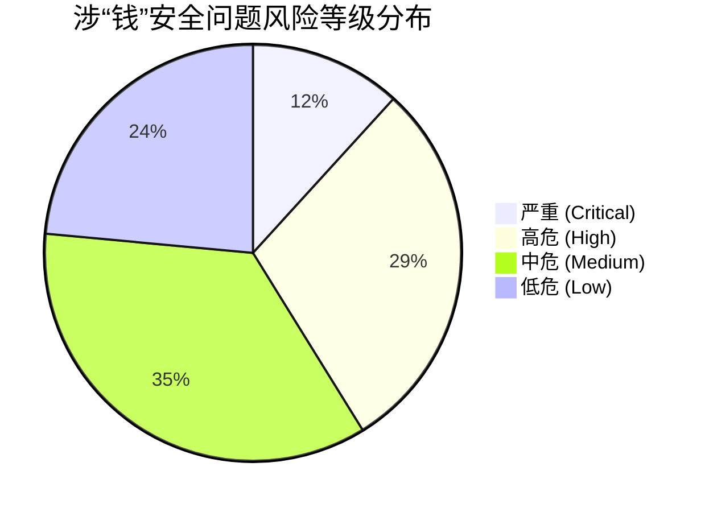

# AI-Helper 资金与资产安全专项审核报告（“钱”核心链路）

> **审核时间**：2026-10-17  
> **审核范围**：AI-Helper 客户端核心通信、本地网关（Accio Bridge）、渠道分组与倍率切换、凭证存储、API 握手测试、自动更新与安装模块  
> **核心导向**：**“钱！”** —— 全面排查云端余额、API Key 额度、计费倍率、异常消耗、资产盗刷及供应链资金风险

---

## 目录
1. [审核综述与风险分布](#一审核综述与风险分布)
2. [维度一：本地网关与接口防盗刷 / 额度异常损耗](#维度一本地网关与接口防盗刷--额度异常损耗bridge--quota-drain)
3. [维度二：渠道分组与计费倍率安全漏洞](#维度二渠道分组与计费倍率安全漏洞pricing--multipliers)
4. [维度三：更新下载与供应链投毒漏洞](#维度三更新下载与供应链投毒漏洞supply-chain--asset-theft)
5. [维度四：明文资金凭证存储与泄露风险](#维度四明文资金凭证存储与泄露风险credentials--storage)
6. [维度五：汇率硬编码、测试损耗与运行时崩溃](#维度五汇率硬编码测试损耗与运行时崩溃precision--stability)
7. [核心 Top 3 紧急加固项与修复路线](#七核心-top-3-紧急加固项与修复路线)

---

## 一、审核综述与风险分布

在最近一轮修改中，项目已封堵了部分显性漏洞（如移除创建无限配额 Token 的 `create_user_token`、测试增加 `max_output_tokens: 16`、Unix 平台配置文件限制 `0o600` 等）。但在深入复审后发现，在**“大小写敏感性”、“Fail-Open 默认放行逻辑”、“本地非浏览器通信鉴权”以及“降级分支默认清空防护”**等细节上，依然存在可能导致用户资金巨额损耗或资产被盗的盲区。

### 风险等级统计矩阵

| 风险等级 | 数量 | 核心危害概要 |
| :--- | :---: | :--- |
| **CRITICAL (严重)** | **2** | 渠道倍率检测大小写失效导致 5~10x 扣费无感切换；更新验签 Fail-Open 导致整机私钥凭据失守 |
| **HIGH (高危)** | **5** | 本地 Bridge 允许任意进程免密盗刷；DALL-E 3 高额生图缺乏预算硬限；降级分支清空模型/IP 白名单等 |
| **MEDIUM (中危)** | **6** | 收费端点缺乏金额熔断；Claude/Codex 无本地风控；Windows 会话明文存储；汇率硬编码失真等 |
| **LOW (低危)** | **4** | 剪贴板未超时清空；未筛选用户可用分组；推理模型握手消耗；UTF-8 字符截断崩溃隐患 |



---

## 维度一：本地网关与接口防盗刷 / 额度异常损耗（Bridge & Quota Drain）

### 1. 【高危】Accio 本地 Bridge 完全缺乏进程级通信鉴权（本地任意进程自由盗刷额度）
* **涉及文件**：`src-tauri/src/accio/bridge.rs` (`is_trusted_bridge_origin` & `bridge_anti_csrf_middleware`)
* **细节遗漏**：
  * 现有的 `bridge_anti_csrf_middleware` 重点防范浏览器的跨站 CSRF 和 DNS Rebinding。
  * `is_trusted_bridge_origin` 明确包含：
    ```rust
    if lower.is_empty() {
        return true;
    }
    ```
  * 浏览器外的本地进程（例如本地运行的任意恶意脚本、后台后门、第三方软件，使用 `curl`、`python` 或原生 TCP 请求）发起 HTTP POST 时**不会附带 Origin 与 Sec-Fetch-Site 头部**，中间件直接放行。
* **资金危害**：本地任何程序向 `http://127.0.0.1:8787/api/adk/llm` 发送请求，Bridge 会无条件自动附加用户的真实 `config.api_key` 转发至大模型并扣费，**用户云端余额可被本机任意软件免密借用并迅速耗尽**。
* **整改方案**：
  1. 拉起 Accio Work 进程时，动态生成一次性 Session Token 并通过环境变量（如 `GATEWAY_AUTH_TOKEN`）注入子进程。
  2. Bridge 端点强制校验请求头中的 Authorization Bearer 令牌；或比对发起连接的本地 socket 所属 PID。

---

### 2. 【高危】生图接口 `call_custom_image` 模型写死 `dall-e-3` 且缺乏会话预算兜底
* **涉及文件**：`src-tauri/src/accio/bridge.rs` (`call_custom_image`)
* **细节遗漏**：
  * 模型被无条件写死为 `"dall-e-3"`，尺寸根据宽高比自动指定 `1792x1024` 或 `1024x1792` 高清规格（官方单张高达 $0.08，约合 0.6 元人民币/张）。
  * 虽然限制了 6 次/分钟，但 1 小时内依然允许生成 360 张，**1 小时即可消耗近 200 元人民币**。
  * **重试二次扣费陷阱**：若上游生图已成功，但由于网络波动在下载临时 URL 或 Base64 转码环节超时，函数返回 `Err`，但**云端配额已被扣除**。上层 Agent 收到报错后通常会进入 Retry 重试逻辑（2~3 次），导致用户被重复计费。
* **整改方案**：
  1. 提供生图模型可选配置（支持低成本的 SD / Flux 等）。
  2. 增加单日/单会话生图消费预算硬限（如每日上限 10 张，超限需手动确认）。
  3. 捕获重试行为并提供清晰扣费提示。

---

### 3. 【中危】收费端点仅限频（120次/分）缺乏“金额 / Tokens 累计熔断”机制
* **涉及文件**：`src-tauri/src/accio/bridge.rs` (`SlidingWindowRateLimiter`)
* **细节遗漏**：120 次/分钟限流对防爆破有效，但对长上下文调用（如 128k 上下文）而言，120 次请求可在数分钟内消耗数百万 Tokens，瞬间清空几百元余额。
* **整改方案**：增加会话级消费熔断器，当 5 分钟内连续消耗超过设定阈值时自动暂停请求并提示用户确认。

---

### 4. 【中危】Claude Code / Codex / WorkBuddy 缺乏本地统一代理防护
* **涉及文件**：`src-tauri/src/claude.rs`、`src-tauri/src/codex.rs`、`src-tauri/src/workbuddy.rs`
* **细节遗漏**：当前仅 Accio Work 经过本地 Bridge 守护，其余 CLI 与工具均直接直连云端。如果用户在后台运行带有死循环的自动化脚本，没有任何本地限额守护。

---

## 维度二：渠道分组与计费倍率安全漏洞（Pricing & Multipliers）

### 5. 【严重】`groupRatio` 大小写敏感 Bug 导致“高倍率警告与二次确认”被完全绕过
* **涉及文件**：`src/components/ChannelGroupMonitor.tsx`
* **代码定位**：第 1883 行、第 2291 行、第 2359 行
* **细节遗漏**：
  * 判断高倍率的逻辑为：
    ```ts
    const targetRatio = pricingInfo.groupRatio[switchModalState.targetGroupName] ?? 1.0;
    ```
  * 在 NewAPI / OneAPI 规范中，分组名称大小写常有差异（例如通道大盘返回 `"VIP"`、`"SVIP"`，而定价字典里的 Key 可能是小写 `"vip"`、`"svip"`，反之亦然）。
* **资金危害**：
  * 一旦大小写不匹配，字典查找直接返回 `undefined`，降级为默认倍率 `1.0x`。
  * **结果：高费率警告条不显示、2.0x+ 强制确认勾选框不出现、提交按钮不被阻断！** 用户在不知情的情况下被切换到 5x 或 10x 扣费通道，后续所有调用全部以天价计费。
* **整改方案**：进行小写归一化（Case-insensitive）匹配：
  ```ts
  const findRatio = (group: string) => {
    const key = Object.keys(pricingInfo.groupRatio).find(
      (k) => k.toLowerCase() === group.toLowerCase()
    );
    return key ? pricingInfo.groupRatio[key] : 1.0;
  };
  ```

---

### 6. 【高危】`update_user_token_group` 降级分支静默清空用户原有模型与 IP 防护
* **涉及文件**：`src-tauri/src/auth.rs` (`update_user_token_group`)
* **代码定位**：第 1224 - 1237 行
* **细节遗漏**：
  * 调用 `PUT /api/token/` 时，若第一步 `GET /api/token/:id` 因权限或网络失败，代码进入降级分支并重新构建请求体：
    ```rust
    serde_json::json!({
        "id": orig.id,
        "name": orig.name,
        "expired_time": orig.expired_time,
        "remain_quota": orig.remain_quota,
        "unlimited_quota": orig.unlimited_quota,
        "model_limits_enabled": false, // ⚠️ 强制关闭限制
        "model_limits": "",            // ⚠️ 清空模型白名单
        "allow_ips": "",                // ⚠️ 清空 IP 白名单
        "group": clean_group,
        ...
    })
    ```
* **资金危害**：若用户原本在 Web 端设置了防御策略（例如：限制该 Key 只能调用廉价小模型，或限制特定 IP 以防泄露），一旦在客户端改分组触发该降级分支，**原有的模型限制和 IP 限制被静默彻底清空**，使该 Key 瞬间变成可在全球任意 IP 调用昂贵顶级模型的全权 Token。
* **整改方案**：降级分支中不得主动关闭安全限制，若无法取到原完整参数，应报错中断并提示用户在控制台操作。

---

### 7. 【中危】“全套同步 Agent”将高倍率 Token 无差别普及到后台所有工具
* **涉及文件**：`src/components/ChannelGroupMonitor.tsx`（第 571 - 582 行）
* **细节遗漏**：切换分组若勾选“同步到所有工具”，高倍率 Key 会被立即同步至 Codex、Claude、WorkBuddy。用户原本只想在特定会话中体验高速通道，却导致后台所有日常开发工具全部按高倍率扣费。

---

### 8. 【低危】未校验用户可用分组白名单（`user_available_groups`）
* **涉及文件**：`src/components/ChannelGroupMonitor.tsx`
* **细节遗漏**：监控看板展示的是全站可用通道，可能包含倍率奇高或私有测试通道。接口已获取 `user_available_groups`，但 UI 层面未对不可用通道做置灰拦截。

---

## 维度三：更新下载与供应链投毒漏洞（Supply-Chain / Asset Theft）

### 9. 【严重】安装包更新验签存在 Fail-Open（检验失败仍默认放行执行）严重逻辑缺陷
* **涉及文件**：`src-tauri/src/updater.rs` (`download_and_install_update`)
* **代码定位**：第 898 - 930 行
* **细节遗漏**：
  ```rust
  if let Some(sums_text) = fetch_release_sha256sums(&client, clean_ver).await {
      if let Some(expected_hash) = parse_expected_hash(&sums_text, &target_installer_name) {
          // 比对实际哈希...
      } else {
          log::warn!("SHA256SUMS.txt 中未找到匹配 ... 跳过哈希校验");
      }
  } else {
      log::warn!("未能从任何备用源检索到权威 SHA256SUMS.txt 清单");
  }

  // ⚠️ 无论是否匹配，流程继续执行：
  let _ = on_event.send(UpdateDownloadEvent::Finished);
  std::process::Command::new(&temp_file_path)...spawn();
  ```
* **资金危害**：
  * 更新源列表中包含多个第三方镜像（如 `ghfast.top`、`gh-proxy.com` 等）。
  * 若第三方反代遭遇供应链攻击或 DNS 劫持，攻击者只需对 `SHA256SUMS.txt` 返回 404 或阻断该请求，**客户端便打一条 warn 日志，随后直接以管理员权限静默调起恶意安装包运行！**
  * 木马一旦执行，宿主机内的加密货币钱包、Bob API 会话 Cookie 及所有 API Key 将在数秒内被洗劫一空。
* **整改方案**：**严格执行 Fail-Closed 原则**。未能获取有效权威哈希或校验不匹配时，必须立即删除临时文件、报错退出，绝不能运行未通过验证的程序。

---

### 10. 【高危】`SHA256SUMS.txt` 自身缺乏数字签名保护
* **涉及文件**：`src-tauri/src/updater.rs` (`fetch_release_sha256sums`)
* **细节遗漏**：哈希清单自身也是从可能被劫持的第三方镜像下拉的。恶意镜像可以同时替换恶意安装包与对应的伪造哈希。
* **整改方案**：权威哈希必须只从官方可信站点拉取，或者必须校验基于非对称公钥（Minisign / Ed25519）的数字签名（即 `updater.key.pub`）。

---

### 11. 【中危】`run_installer_file` Tauri IPC 命令未限制目标路径与文件类型
* **涉及文件**：`src-tauri/src/installer_download.rs` (`run_installer_file`)
* **细节遗漏**：暴露给前端的 IPC 命令对 `file_path` 未做白名单限制，若前端存在 XSS 漏洞，可被利用来调用启动本地任意程序。

---

## 维度四：明文资金凭证存储与泄露风险（Credentials & Storage）

### 12. 【高危】Windows 平台会话凭据 (`auth_session.json`) 未加密保存
* **涉及文件**：`src-tauri/src/auth.rs` (`persist_session`)
* **细节遗漏**：上次提交中虽然加入了 Unix `0o600` 权限，但 AI-Helper 主要运行在 Windows 平台。Windows 下 `~/.ai-helper/auth_session.json` 是一个**明文 JSON 文件**，其中完整存储了包含平台控制权的 `refresh_cookie` 与 `session_sid`。
* **资金危害**：同机运行的普通权限程序可直接读取该文件获取 Cookie，远程接管该用户的 Bob-API 平台账号，盗用账户所有余额。
* **整改方案**：在 Windows 上引入 DPAPI (`CryptProtectData`) 进行机器/用户级数据加密存储。

---

### 13. 【中危】本地 Agent 配置多处明文存 Key，且覆写遗留 `.bak` 备份文件
* **涉及文件**：`src-tauri/src/claude.rs`、`src-tauri/src/codex.rs`、`src-tauri/src/accio/config.rs`
* **细节遗漏**：
  * `claude.rs` 与 `codex.rs` 写入配置时会先将旧文件备份为 `settings.json.bak` 或 `config.toml.bak`。
  * 用户即使在界面中删除了 Key，历史 Key 仍然在 `.bak` 文件中永久留存。
  * `accio_config.json` 在 Unix 平台未配置 `0o600` 权限。

---

### 14. 【低危】剪贴板一键复制 API Key 缺乏自动超时清空
* **涉及文件**：`src/components/auth/TokenSelectModal.tsx` (`handleCopyKey`)
* **细节遗漏**：明文复制至剪贴板后长期驻留，易被其他软件的剪贴板监听程序捕获。建议在 60 秒后自动清空剪贴板。

---

## 维度五：汇率硬编码、测试损耗与运行时崩溃（Precision & Stability）

### 15. 【中危】汇率与计费单元写死，引发资产展示失真与消费争议
* **涉及文件**：`src-tauri/src/auth.rs`、`src/components/account/UsageLogsPanel.tsx`
* **细节遗漏**：
  * 后端写死 `rmb_to_usd_rate: 4.0; quota_per_unit: 500000;`
  * 前端 UI 写死 `(1￥=4$)`，日志统计中直接除以 `500000`。
* **资金危害**：若平台调整了兑换汇率或采用浮动汇率，客户端折算的人民币余额将与服务端实际账单脱节，容易引发用户对扣费准确性的质疑与经济纠纷。
* **整改方案**：汇率比例应从 `/api/status` 或钱包接口动态获取。

---

### 16. 【中危】`sanitize_error` 中 `truncate(300)` 存在 UTF-8 字符边界截断崩溃
* **涉及文件**：`src-tauri/src/api_test.rs` (`sanitize_error`)
* **代码定位**：第 628 - 631 行
* **细节遗漏**：
  ```rust
  if cleaned.len() > 300 {
      cleaned.truncate(300); // ⚠️ 未验证 is_char_boundary
      cleaned.push_str("... (截断)");
  }
  ```
* **业务关联**：在上游返回中文错误（如“账户余额不足，请前往平台充值后再试...”）时，若第 300 字节正好切断了多字节中文字符，Rust 的 `truncate` 会直接触发 **Panic 导致客户端闪退**。用户不仅看不到余额不足的提示，还会因闪退而误判为系统 Bug 并反复重试。
* **整改方案**：使用 `floor_char_boundary(300)` 或字符迭代截断。

---

### 17. 【低危】思考模型（Reasoning Models 如 o1/o3/r1）握手测试可能消耗高额 Token
* **涉及文件**：`src-tauri/src/api_test.rs`
* **细节遗漏**：虽然限制了 `max_output_tokens: 16`，但对于具备深度思考机制的模型（OpenAI o1/o3、DeepSeek R1 等），即使最终只输出 16 个 token，后台思考阶段可能依然会消耗成百上千个思考 tokens（且思考 token 计费较贵）。
* **整改方案**：测试时若检测到模型属于推理系列，显式追加 `"reasoning_effort": "low"` 或传入降低思考消耗的参数。

---

## 七、核心 Top 3 紧急加固项与修复路线

为确保用户资金安全不受瞬时威胁，建议立即按以下优先级安排修复：

1. **第 5 项（大小写敏感导致高费率防线失效）**：修复字典匹配归一化，确保 2x~10x 通道的高费率警告与二次确认 100% 触发生效。
2. **第 9 项（更新下载 Fail-Open 逻辑缺陷）**：将哈希校验改为强约束的 Fail-Closed，绝不在哈希未匹配或缺失时启动安装程序。
3. **第 6 项（分组切换降级分支清空安全防护）**：移除 `model_limits_enabled: false` 等硬编码字段，避免用户自主配置的防盗刷白名单被清空。
