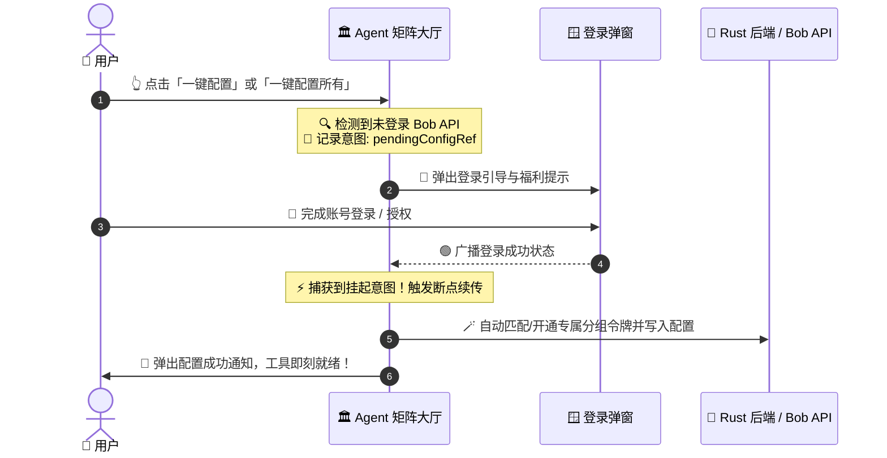

# AI Helper v1.0.74 🚀✨🎉
>
> 📅 **发布日期**：2026年10月31日 🎃🌟
> 🏷️ **版本代号**：Smart Matrix Auto-Provisioning & Domestic GLM-5.3 🧠⚡🪄🇨🇳

---

## 🌟 导读速览 · 精彩亮点 💡🔥

本次 **v1.0.74** 迎来了工作台配置体系的**划时代升级**！我们彻底推翻了以往“单一令牌一刀切配置”的传统模式，打造了全链路**智能分组匹配** 🎯、**令牌无感自愈创建** 🪄、**未登录意图断点续传** 🔄 以及**国产顶级大模型基座全面就绪** 🇨🇳 的极致体验！

- 🎯 **Agent 矩阵专属分组智能分发**：根据不同 Agent 的最佳模型适配场景，自动划分三大专属分组（`CC-Kiro-Max` / `Codex-不降质` / `国产Token计划`），一键配置按需精准定向注入 🤖⚡
- 🪄 **缺省令牌全自动创建与安全托管**：账号下暂无对应分组令牌？无需手动前往网页创建，系统毫秒级全自动在 Bob API 开通专属令牌并登记受管凭据 🔑🛡️
- 🔄 **未登录“断点续传”极致交互**：未登录点击配置时自动记忆用户意图，登录成功瞬间自动无缝恢复执行一键配置，免去二次点击烦恼 🚪💫
- 🇨🇳 **国产强力大模型全面默认预设**：Cursor、WorkBuddy 与 Accio Work 默认基座模型全面升级为高质量高性价比的 `glm-5.3`，开发体验飙升 🚀🔥
- 🧱 **底层架构与全渠道版本同步升级**：Tauri Rust 后端、前端 API、诊断核心及全网下载镜像源全线升级至 **v1.0.74** 📦🌐

---

## 🤖 工作台：Agent 矩阵专属分组智能分发体系 🎯⚡

以往的“一键配置”会将同一个 API Key 覆盖给所有工具，无法发挥各大模型平台的专属模型与分组算力优势。在 **v1.0.74** 中，Agent 矩阵大厅全面迈入**场景化智能路由时代**！🌟

### 🗂️ 三大专属业务分组与推荐模型对齐矩阵
- 🟧 **Claude Code CLI** ➔ 绑定专属分组 **`CC-Kiro-Max`** 🦊⚡
  - 🧠 **推荐模型**：`claude-sonnet-5-5`
  - 🎯 **适用场景**：终端命令行复杂工程逻辑理解、超长代码上下文重构与自动化调试。
- 🟩 **Codex CLI / ChatGPT 桌面端** ➔ 绑定专属分组 **`Codex-不降质`** 🟢💬
  - 🧠 **推荐模型**：`gpt-5.6-sol`
  - 🎯 **适用场景**：官方桌面端高保真交互、日常代码片段生成与高准确度逻辑推理。
- 🔮 **Cursor / WorkBuddy / Accio Work** ➔ 绑定专属分组 **`国产Token计划`** 🚀🇨🇳
  - 🧠 **默认推荐模型**：`glm-5.3`
  - 🎯 **适用场景**：IDE 内全天候代码补全、沉浸式内嵌生成与超低延迟智能协作。

### 🪄 「一键配置所有」智能归类批量注入
- 🧩 **多对多分组自动聚合**：点击「一键配置所有」按键后，系统会自动对所有已安装工具按目标分组进行聚类分析（`targetsByGroup`）📊。
- ⚡ **分批独立写入**：分别拉取或创建对应分组的凭据与推荐模型，并行分发至对应工具配置中 🛠️。
- 📋 **精细化结果反馈**：配置完成后，通知弹窗清晰呈现每个工具所归属的分组名称与推荐模型，让每一次配置都透明可见、心里有数 💯✨。

---

## 🔑 令牌自愈革命：全自动远程创建与受管凭据托管 🛡️🪄

再也不用为了配置一个工具，先打开浏览器去控制台手动建令牌、起名字、复制 Key 了！一切交给 AI Helper 搞定 🚀！

### ⚡ 零门槛无感自愈创建 (`create_user_token`)
- 🤖 **按需动态探测**：一键配置时，系统依次执行「已绑定令牌校验 ➔ 同分组有效令牌检索 ➔ 缺省自动创建」三级机制 🔍。
- 🪄 **自动向服务端开通**：若当前账号下暂无目标分组的正常令牌，Rust 后端直接调用 Bob API 令牌开通端点，以最佳预设（无限额度、永不过期）快速生成专属 Token 🌟。
- 🏷️ **语义化自动命名**：
  - 🟧 `Claude Code 专属令牌 (CC-Kiro-Max)`
  - 🟩 `Codex 专属令牌 (Codex-不降质)`
  - 🇨🇳 `国产模型专属令牌 (国产Token计划)`
  云端与本地账目清晰可辨，管理井井有条 🧾✨。

### 🔒 凭据安全政策与明文登记
- 🛡️ **安全通道拉取未截断明文**：令牌创建成功后，统一调用专用明文端点读取完整凭据 🔐。
- 🗝️ **接入凭据受管体系**：自动调用 `register_managed_key` 登记至本地受管凭据缓存与安全沙盒，既杜绝了明文在日志中泄露的风险，又保障了跨组件调用畅通无阻 🛡️💯。

---

## 🔄 交互丝滑跃迁：未登录意图记忆与“断点续传” 🚪💫

我们针对新用户与未登录用户的首发上手流程进行了深入的无障碍体验重构 💡✨！

### 🎯 体验细节优化
- 💡 **主动挂起意图**：未登录时点击卡片，系统将操作类型与目标 Agent 暂存至 `pendingConfigRef` 中，并弹出贴心指引（“新用户登录立享体验额度”）🎁。
- 🚀 **登录即生效**：监听 `authState.is_logged_in` 状态变化，一旦登录成功，无需用户重新寻找按钮再次点击，系统自动无感恢复执行此前挂起的操作 🪄🎉。
- 🧼 **优雅清理与容错**：组件卸载或动作执行完毕后自动重置挂起引用，严防重复触发与状态泄漏 🛡️。

---

## 🇨🇳 默认模型升级：全面拥抱国产顶尖大模型 `glm-5.3` 🇨🇳🔥

为了给开发者带来极速响应与超高性价比的代码协作体验，本版本针对国内友好型工具链完成了基座模型的全新换代 🌟！

- 🇨🇳 **全面预设 `glm-5.3`**：
  - 🪄 **Accio Work**：默认模型升级为 `glm-5.3` ⚡
  - ⚡ **Cursor IDE**：默认模型由原先的 `gpt-5.6-sol` 升级为 `glm-5.3` 💎
  - 💼 **WorkBuddy**：默认模型同步升级为 `glm-5.3` 🚀
- 🛡️ **尊重既有选择，绝不暴力覆盖**：
  - 采用智能的 `model_or_default` 检测逻辑：若用户之前在本地配置文件中已经设定了心仪的模型，系统将**百分之百尊重并保留原配置** 🛡️。
  - 仅在初次配置或字段为空时，智能推荐并填入最契合当前分组的推荐模型 🎯。

---

## 🛠️ 底层架构与安全一致性打磨 🧱🔒

- 🦀 **Rust 后端架构精简**：
  - 在 `src-tauri/src/auth.rs` 中新增 `create_user_token` 异步处理逻辑，封装健全的网络请求、状态码归一化与序列化兜底方案 🛡️。
  - 在 `src-tauri/src/lib.rs` 中规范注册 `create_user_token` Tauri IPC Command ⚙️。
- 🌐 **前端 API 层同步对接**：
  - 在 `src/lib/api.ts` 中暴露强类型的 `createUserToken(name, group)` 接口方法 💻。
- 🖥️ **本地存储去敏感化**：
  - 本地缓存严格遵循安全准则，只保留关联令牌的元数据（`id`, `name`, `group`），绝不将任何未加密的明文 API Key 留存在本地 `localStorage` 中 🔒。

---

## 📦 各平台安装包下载与高速镜像 🔗📥

| 操作系统 / 平台架构 💻 | 安装包类型 📦 | 官方源站直链 🌐 | 国内极速镜像 🚀 |
| :--- | :--- | :--- | :--- |
| **Windows x64** 🪟 | NSIS 标准安装包 (`.exe`) | [立即下载 ⬇️](https://helper.bob-api.com/downloads/AI-Helper-v1.0.74-Windows-x64-Setup.exe) | [高速镜像 ⚡](https://ghfast.top/https://github.com/TF49/AI-Helper/releases/download/v1.0.74/AI-Helper-v1.0.74-Windows-x64-Setup.exe) |
| **Windows x64** 🪟 | Standalone 便携免安装 (`.zip`) | [立即下载 ⬇️](https://helper.bob-api.com/downloads/AI-Helper-v1.0.74-Windows-x64-Standalone.zip) | [高速镜像 ⚡](https://ghfast.top/https://github.com/TF49/AI-Helper/releases/download/v1.0.74/AI-Helper-v1.0.74-Windows-x64-Standalone.zip) |
| **macOS Apple Silicon** 🍏 | M1 / M2 / M3 / M4 架构 (`.dmg`) | [立即下载 ⬇️](https://helper.bob-api.com/downloads/AI-Helper-v1.0.74-macOS-aarch64.dmg) | [高速镜像 ⚡](https://ghfast.top/https://github.com/TF49/AI-Helper/releases/download/v1.0.74/AI-Helper-v1.0.74-macOS-aarch64.dmg) |
| **macOS Intel** 🍏 | x86_64 经典架构 (`.dmg`) | [立即下载 ⬇️](https://helper.bob-api.com/downloads/AI-Helper-v1.0.74-macOS-x64.dmg) | [高速镜像 ⚡](https://ghfast.top/https://github.com/TF49/AI-Helper/releases/download/v1.0.74/AI-Helper-v1.0.74-macOS-x64.dmg) |

---

## 💡 升级指南与温馨提示 💬💖

1. 🪄 **一键体验新矩阵**：升级至 **v1.0.74** 后，强烈建议打开主界面工作台大厅，点击左下角的「**一键配置所有**」按键 🌟！系统将根据最新的场景分组为您自动分配最合适的令牌并配置 `glm-5.3` / `claude-sonnet-5-5` / `gpt-5.6-sol` 推荐模型 ⚡。
2. 🔄 **静默自动更新**：已运行客户端的用户稍后将收到更新气泡提示，点击「立即更新」即可享受丝滑的自动下载升级 🚀。
3. 📮 **问题反馈与支持**：如在使用过程中遇到任何疑问或宝贵建议，欢迎通过应用右上角的「**意见反馈**」💬 提交，或前往 [GitHub Issues](https://github.com/TF49/AI-Helper/issues) 与我们交流，感谢大家的持续支持与喜爱！🙌🎉✨
