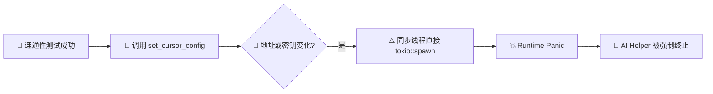
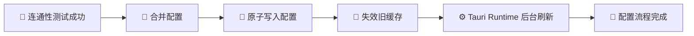

# AI Helper v1.0.75 🚀🎉✨🛠️
>
> 📅 **发布日期**：2026年11月5日 🍂🗓️
> 🏷️ **版本代号**：Cursor Stability & Production Build Recovery 🖱️🛡️🏗️

---

## 🌟 更新速览 · Cursor 配置链路稳定性升级 ⚡🧭

本次 **v1.0.75** 聚焦 Cursor 配置流程中的关键稳定性问题，解决了模型连通性测试成功后，AI Helper 在写入配置阶段突然退出的问题 💥➡️🛡️。同时修复模型缓存隔离、配置保存顺序、测试弹窗状态竞争以及生产版前端资源嵌入流程，让 Cursor 从“测试成功”到“配置落盘、Bridge 启动、客户端生效”的整条链路更加可靠 🚀🔗✅。

- 🛑 **修复 Cursor 配置成功后 AI Helper 闪退**：消除同步 Tauri IPC 命令中错误调用异步运行时导致的原生 panic 💣🦀
- 💾 **配置先落盘、缓存后刷新**：避免后台任务抢先读取旧地址或旧密钥，保证配置状态一致 🔄📁
- 🧹 **模型缓存严格隔离**：切换 API 地址或密钥时自动清理旧模型缓存，杜绝跨凭据串用 🗝️🚧
- 🪟 **测试终端交互稳定性提升**：稳定关闭与成功回调，避免倒计时 effect 被重复触发 ⏳🧘
- 🏗️ **生产构建流程校正**：正式产物正确嵌入前端资源，不再错误访问 `localhost:3000` 🌐📦
- 🧪 **完整质量验证**：Rust 全量测试、TypeScript 类型检查、Clippy 与 rustfmt 全部通过 ✅💯

---

## 🛑 关键修复：Cursor 测试成功后不再闪退 💥➡️✅

### 🔍 问题表现

部分用户在 Cursor 配置向导中会遇到以下情况：

1. 🚀 启动 Cursor IDE 连通性测试与配置流程
2. 🌐 上游接口成功返回 `HTTP 200 OK`
3. 💬 模型正确响应测试消息
4. 💾 界面显示“正在将配置写入 `~/.ai-helper/cursor_config.json`”
5. 💥 AI Helper 客户端突然退出，配置没有完成保存

Windows 事件记录会将该问题标记为 `BEX64 / 0xc0000409` ⚠️🪟。实际发生崩溃的是 **AI Helper 自身**，并不是 Cursor IDE，也不是上游模型接口连接失败 🎯🧩。

### 🧠 根因定位

Cursor 配置保存命令属于同步 Tauri IPC Command，但旧逻辑在检测到 API 地址或密钥发生变化时，直接调用了 `tokio::spawn` 启动缓存刷新任务 🦀⚙️。

同步 IPC 工作线程并不保证已经进入 Tokio Runtime，因此该调用可能触发运行时 panic 💣。panic 穿过不可 unwind 的 IPC 边界后，会被 Windows 作为快速失败处理，最终导致整个客户端被强制终止 🚫🖥️。



### 🛠️ 修复方案

- 🦀 使用 **Tauri 全局异步运行时** `tauri::async_runtime::spawn` 调度模型缓存刷新任务，确保同步 IPC 线程也能安全启动异步工作 ⚙️✅
- 💾 将配置保存操作提前，确保 `cursor_config.json` 成功落盘后再启动后台刷新任务 📁🔒
- 🧭 后台任务始终读取最新的服务地址、API Key 与模型设置，不再与配置写入产生竞态条件 🏁🔄
- 🛡️ 即使模型缓存刷新失败，也不会影响已经完成的配置保存，更不会导致客户端退出 🌦️✅



---

## 🧹 模型缓存一致性与凭据隔离升级 🔐📚

### 🚧 切换上游服务时彻底隔离旧缓存

旧版本在前端省略缓存字段时，会自动继承本地已有的 `cached_models`。当用户更换 API 地址或 API Key 后，这一行为可能把旧凭据对应的模型列表错误地绑定到新凭据上 🔀⚠️。

v1.0.75 引入更严格的模型源指纹判断机制 🧬🔍：

- 🔑 **API Key 变化**：立即清空旧模型列表与缓存指纹 🧹
- 🌐 **Base URL 变化**：立即清空旧模型列表与缓存指纹 🧹
- ✂️ **URL 仅存在 `/v1` 或末尾斜杠差异**：自动规范化后视为同一来源，避免不必要的缓存失效 🧠
- ✅ **地址与密钥均未变化**：保留已验证的模型缓存，减少重复网络请求 ⚡
- 🎯 **用户主动提交新模型列表**：重新生成正确的模型源指纹并安全保存 🏷️

### 📦 缓存归属更加清晰

模型列表现在始终与以下组合绑定：

```text
normalized_base_url + API Key = model source fingerprint
```

这意味着不同中转站、不同账号与不同令牌之间不会共享错误的模型目录 🔒🧱，从而避免出现以下问题：

- 🚫 新密钥看到了旧密钥才有权限使用的模型
- 🚫 切换服务商后仍展示上一服务商的模型列表
- 🚫 Bridge 启动后使用旧配置刷新并覆盖新配置
- 🚫 测试成功但实际请求发送到错误的模型来源

---

## 🪟 Cursor 测试终端交互稳定性优化 ⏳✨

除原生崩溃外，本次更新还优化了连通性测试弹窗的 React 状态管理，让成功反馈、倒计时关闭与父组件刷新之间更加稳定 🧩⚛️。

- 🧷 使用稳定的 `onClose` 回调，避免父组件重渲染时不断创建新函数引用 🔄
- 🗃️ 通过 Ref 始终读取最新关闭回调，避免倒计时 effect 因依赖变化被重复清理和重建 ⏱️
- ✅ 测试成功后先完成弹窗内部状态更新，再通知父组件刷新配置摘要 📋
- 🎉 成功 Toast、重启提示卡片、运行状态检查与自动关闭倒计时保持正确顺序 🥳
- 🧘 降低快速重渲染导致重复回调、提前关闭或界面状态错乱的概率 🛡️

---

## 🏗️ 正式生产构建与前端资源嵌入修正 📦🌐

本次排查过程中还发现，若仅使用裸 `cargo build --release` 构建桌面程序，Tauri 可能无法获得完整的生产构建上下文，导致生成的 WebView 仍尝试访问开发地址 `http://localhost:3000` 🧑‍💻⚠️。

### ✅ 生产构建流程统一

- 🏗️ 正式产物统一通过 **Tauri CLI** 构建
- 🎨 自动执行 Vite 前端生产编译
- 📦 将 `dist` 中的 HTML、CSS、JavaScript 与图片资源正确嵌入桌面应用
- 🚫 正式版不再依赖本地 Vite 开发服务器
- 🌐 彻底解决启动后显示 `localhost 拒绝连接 / ERR_CONNECTION_REFUSED` 的问题
- 🪟 已对最终桌面可执行文件进行真实窗口启动验证，首页与 Agent 矩阵均可正常显示 ✅

```text
✅ 正确：pnpm tauri build --no-bundle
⚠️ 避免：cargo build --release（直接作为最终桌面发布产物）
```

---

## 🧪 测试、质量与回归验证实验室 🔬✅💯

本次更新不是只修复表面现象，而是对配置逻辑、缓存策略、代码质量与真实产物进行了完整验证 🧪🛡️。

### 🦀 Rust 后端验证

- ✅ Cursor 配置定向单元测试：**3 passed / 0 failed** 🎯
- ✅ Rust 全量测试：**290 passed / 0 failed / 5 ignored** 🧪
- ℹ️ 5 个忽略项为需要隔离系统凭据服务或独立子进程环境的显式测试，不属于失败项 🧰
- ✅ `cargo clippy --all-targets -- -D warnings` 零警告通过 🧹
- ✅ `cargo fmt --check` 格式检查通过 📐

### ⚛️ 前端验证

- ✅ TypeScript `tsc --noEmit` 类型检查通过 🔷
- ✅ Vite 生产构建完成 📦
- ✅ 测试终端回调与倒计时依赖稳定化 ⏳

### 🪟 Windows 实机验证

- ✅ 核对 Windows Application Error 与 WER 崩溃记录 🔍
- ✅ 确认原始异常代码 `0xc0000409` 的触发链路 🧭
- ✅ 使用正式生产构建启动最终桌面文件 🚀
- ✅ 首页、Agent 卡片、Cursor 入口与设备管理导航正常渲染 🎨
- ✅ 未再出现 `localhost:3000` 或 `ERR_CONNECTION_REFUSED` 🌐

---

## 📋 技术变更清单 🧰🧱

| 模块 🧩 | 更新内容 🛠️ | 用户收益 🎁 |
| :--- | :--- | :--- |
| Cursor 配置命令 🦀 | 使用 Tauri 全局异步运行时 | 消除配置阶段原生闪退 🛡️ |
| 配置保存顺序 💾 | 先落盘，再刷新模型缓存 | 后台任务始终读取最新配置 ✅ |
| 模型缓存策略 🧹 | 凭据变化时清空旧缓存 | 避免模型列表跨账号串用 🔐 |
| URL 指纹规范化 🧬 | 统一处理 `/v1` 与末尾斜杠 | 减少无效缓存刷新 ⚡ |
| 测试终端弹窗 🪟 | 稳定关闭与成功回调 | 倒计时和成功反馈更可靠 ⏳ |
| 生产构建流程 🏗️ | 由 Tauri CLI 嵌入前端资源 | 桌面版离线启动正常 📦 |
| 自动化测试 🧪 | 增加同源保留与异源清理用例 | 防止缓存逻辑回归 🚧 |

---

## 💡 升级指南与温馨提示 🔄💖

1. 📥 **升级到 v1.0.75**：建议退出正在运行的旧版 AI Helper 后再安装或替换新版本，确保所有原生进程与 WebView 资源同步更新 🔄。
2. 🖱️ **重新执行 Cursor 配置**：打开「Cursor ➔ 一键配置」，完成模型连通性测试；看到 `HTTP 200 OK` 后，程序会继续保存配置并启动 Bridge，不再突然退出 🚀。
3. 🧹 **无需手动删除模型缓存**：更换 API 地址或密钥时，v1.0.75 会自动识别来源变化并清理旧缓存 🪄。
4. 🌐 **若仍看到 localhost 错误**：请确认运行的文件版本为 v1.0.75，并完全退出旧进程后重新启动；正式发布包不需要本地开发服务器 🏗️。
5. 📮 **问题反馈**：如遇到其他 Cursor、Bridge 或模型列表问题，可通过应用内「意见反馈」提交日志，或前往 [GitHub Issues](https://github.com/TF49/AI-Helper/issues) 交流 💬🙌。

---

## 🎉 致谢 💙🌟

感谢每一位帮助复现、提供截图与耐心验证的用户 🙏📸！v1.0.75 将 Cursor 配置链路从网络测试、配置保存、缓存刷新到生产启动进行了完整加固 🛡️🔗。希望这次更新让每一次配置都能真正做到：**测试成功 ✅、保存成功 💾、启动成功 🚀、稳定不闪退 🧘**！🎊🎉✨
