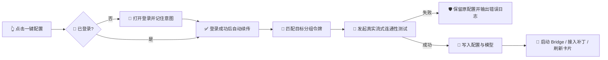

# AI Helper v1.0.77 🌌🚀✨🤖
>
> 📅 **发布日期**：2026 年 11 月 6 日 🍂🗓️  
> 🏷️ **版本代号**：全息 Agent 矩阵 · 自动部署与 Bridge 自愈升级 🌐🧠🛠️  
> 🎯 **核心关键词**：3D 体素展台、批量连通性测试、分组令牌、Cursor 接入、端口自适应、不卡顿后台任务 🔑🧩🛰️⚡

---

## 🌟 更新速览：从“配置工具”进化为“可观测的 Agent 控制台” 🧭✨

v1.0.77 围绕 Agent 矩阵大厅进行了全链路升级 🎉。打开首页即可看到沉浸式 3D 全息展台，卡片中能够直接确认当前客户端的密钥分组与 Model；点击一键配置后，AI Helper 会自动解析专属令牌、发起真实流式连通性测试、写入配置，并在需要时启动本地 Bridge 与接入补丁 🪄🔐📡。

这次更新还重点解决了“端口被占用”“配置后客户端没有立即生效”“窗口探测时短暂卡死”“Cursor 模型下拉列表缺少自定义模型”等容易影响使用连续性的问题 🧯✅。

- 🌌 **全息 Agent 首页**：新增 Three.js 体素多形态舞台与交互式品牌 Logo
- 🧱 **矩阵卡片重构**：六席 Agent 统一展示安装状态、密钥分组与当前 Model
- 🧪 **单卡片真实测试**：配置前先进行流式握手，失败时保留原配置
- 🖥️ **批量部署终端**：一次处理多个 Agent，逐席输出日志、进度与结果
- 🔑 **分组令牌自动匹配**：登录后自动选择专属分组，支持登录完成后的断点续传
- 🔄 **一键重启客户端**：测试通过后可按客户端单独重启，立即加载新配置
- 🖱️ **Cursor Bridge 自愈**：自动避让端口、刷新可用模型、接入补丁并同步端口
- 🔵 **Accio Bridge 更稳**：串行启动、端口回收与模型目录刷新流程更加可靠
- 🧵 **后台任务不阻塞界面**：路径探测、进程扫描和配置读取移入阻塞线程池
- 🌐 **全平台发布同步**：桌面端、官网、诊断页、下载入口统一升级至 `v1.0.77`

---

## 🌌 全新 3D 全息 Agent 首页展台 🧊🪩🌍

首页左侧新增沉浸式 **Voxel Morph Hero**，以 Three.js 体素渲染构建可持续变形的 AI Helper 品牌舞台 🎨✨。模型会在多个形态之间平滑相变，让“网关、协同、算力与矩阵”不再只是文字描述，而是可以直接看到、拖拽和点击的动态视觉体验 🌀🖱️💫。

### 🧬 四种自动相变形态

| 形态 🧩 | 展示名称 🏷️ | 传达的能力 🚀 |
| :--- | :--- | :--- |
| 🌍 | **全球 Anycast 网关** | 全球边缘加速、跨洋低延时路由与多节点连接 |
| ♾️ | **AI-Helper 无限环** | 莫比乌斯流光、循环自省与 Agent 协同 |
| 🧠 | **神经算力芯片** | 端侧沙盒加密、HBM 3D 算力阵列与高速处理 |
| 🧊 | **超维张量矩阵** | 多维嵌入空间、量子晶格核心与模型编排 |

### ✨ 交互与兼容细节

- 🖱️ **拖拽旋转**：在体素舞台上拖拽即可旋转 3D 视角
- ⚡ **点击冲击波**：点击 Logo 会触发全息能量波纹与粒子爆发
- 🌈 **动态流光**：棱镜色散、扫描线、镜面高光与量子星尘持续呼吸
- 🌗 **明暗主题适配**：自动切换浅色与深色 Logo、辉光和材质层
- 📐 **响应式高度**：小窗口自动收紧舞台，高窗口展示更宽松的视觉层次
- 🛟 **WebGL 降级**：检测到浏览器不支持 WebGL 时，自动回退到轻量全息 Logo，不影响核心配置功能
- 🏷️ **状态联动**：底部状态胶囊显示 `AI-Helper Engine Ready` 与当前相变模型名称

> 💡 视觉升级不会改变本地配置文件、令牌绑定和已有工作区；它是纯前端展示层增强，放心体验即可 🎈🔒。

---

## 🧱 Agent 矩阵大厅全面重排：六席客户端一屏掌控 🎯🖥️

v1.0.77 将首页矩阵固定为 **2 列 × 3 行** 的六席布局，并根据窗口宽度与高度自动调整卡片密度 📐📊。卡片不再只显示“已安装/未配置”，而是把真正影响使用的状态放在眼前：密钥分组、当前 Model、可执行操作与运行状态一目了然 👀✅。

### 🤖 六席 Agent 状态

| Agent 🧰 | 说明 💬 | 卡片可执行动作 🛠️ |
| :--- | :--- | :--- |
| 🟠 **Claude Code** | Anthropic 命令行开发 | 一键配置、连通性测试、重启 CLI |
| 🟢 **Codex** | OpenAI 命令行开发 | 一键配置、连通性测试、重启 CLI |
| ⚪ **ChatGPT** | OpenAI 官方桌面客户端 | 打开/拉起客户端，读取共享 OpenAI 配置 |
| 🖱️ **Cursor** | AI First 现代化代码编辑器 | 一键配置、Bridge 接入、重启客户端 |
| 🟩 **WorkBuddy** | 企业级多模型协同工作流 | 一键配置、连通性测试、重启客户端 |
| 🔵 **Accio Work** | 阿里巴巴企业级 Agent | 一键配置、Bridge 启动、重启客户端 |

### 📌 卡片信息更加完整

- 🟡 **密钥分组**：只展示所属分组，不在首页暴露完整 API Key
- 🧮 **Model 信息**：展示当前客户端实际保存的模型名称
- 🕶️ **脱敏策略**：日志中使用 `sk-...XXXX` 等格式展示令牌，避免完整密钥出现在界面
- 🟢 **状态徽章**：已安装、未配置、未安装状态实时反映本地探测结果
- 🔄 **窗口聚焦刷新**：重新回到 AI Helper 时自动同步外部修改
- 📣 **全局同步事件**：单卡片或批量配置成功后，其他页面即时刷新
- 🧠 **跨页面缓存**：短暂切换页面时保留最近一次探测结果，减少状态闪烁
- ⏳ **解析期间保留分组**：云端匹配令牌时不会出现“有分组 → 空白 → 有分组”的跳变

### 📐 小窗口也能完整操作

- 📦 默认紧凑卡片高度约 `160px`，操作按钮不会被窗口底部截断
- 🖥️ 宽屏使用左右分栏：左侧展台与操作区，右侧矩阵网格
- 📱 窄屏自动上下堆叠，并允许整体纵向滚动
- 🪟 高度达到 `820px` 后启用更舒展的 Logo、标签和间距
- 🔍 矩阵内部在空间不足时独立滚动，确保“一键配置”和“重启”始终可达

---

## 🔑 分组令牌与推荐模型自动对齐 🧩🎯

登录 Bob API 后，一键配置会按照目标 Agent 自动解析对应分组令牌，并使用与分组匹配的推荐 Model 🪪🤖。Codex 与 ChatGPT 共享 OpenAI 配置，因此 ChatGPT 卡片会同步展示 Codex 的密钥与模型状态 🔗。

| 配置目标 🎯 | 默认分组 🏷️ | 推荐 Model 🧠 |
| :--- | :--- | :--- |
| 🟠 Claude Code | `CC-Kiro-Max` | `claude-sonnet-5-5` |
| 🟢 Codex / ⚪ ChatGPT | `Codex-不降质` | `gpt-5.6-sol` |
| 🖱️ Cursor | `国产Token计划` | `glm-5.3` |
| 🟩 WorkBuddy | `国产Token计划` | `glm-5.3` |
| 🔵 Accio Work | `国产Token计划` | `glm-5.3` |

### 🚪 登录与配置流程更顺滑

- 🔐 未登录点击一键配置时，自动打开登录弹窗并记住原始操作意图
- ▶️ 登录成功后自动继续刚才的单卡片配置或“配置所有”流程
- 🧾 优先复用已有绑定令牌；找不到可用令牌时再进入创建/获取流程
- 💾 测试成功后记录本地 `bound_token_*` 绑定信息，并广播全局同步事件
- 🧯 配置失败或连通性失败时不覆盖原有配置，避免半配置状态

---

## 🧪 单卡片终端：先验证，再落盘，结果可追踪 🖥️📜✅

点击单个 Agent 的一键配置后，会打开类终端测试窗口，而不是静默修改文件 🧪🔎。终端会持续输出时间戳、当前目标、握手状态、流式响应片段与配置落盘结果，让每一步都能被看见、被复制、被排查。

- 🟦 **真实流式握手**：Claude、Codex、WorkBuddy、Accio Work、Cursor 使用各自测试通道
- 🧭 **端点透明**：展示目标协议地址与即将使用的 Model
- 🧾 **日志分级**：信息、成功、警告、错误与响应片段使用不同颜色区分
- 📋 **一键复制日志**：方便提交反馈或保存排查现场
- 🛡️ **失败保留原配置**：只有测试通过才写入新的 API Key 与 Model
- 🖱️ **Cursor 特殊处理**：配置成功后自动启动 Bridge，并执行接入 AI Helper 补丁
- ⏱️ **倒计时可控**：测试完成后自动关闭；用户选择重启时会暂停倒计时并等待同步任务完成

---

## 🚀 批量一键配置：把六席矩阵变成一条可观察流水线 🧰📡

新增 **Agent 矩阵批量连通性测试与配置终端**，点击“🚀 一键配置所有”后，AI Helper 会逐个处理当前可配置的 Agent，并实时显示 `[当前序号/总数]`、分组令牌、目标端点、握手请求、测试结果和写入结果 📈🖥️。

### 🔁 每一席都会经过同一套安全流程

1. 🏷️ 识别目标 Agent、默认分组与推荐模型
2. 🔑 解析或创建该分组的可用令牌
3. 🕶️ 以脱敏形式写入终端日志
4. 📡 发起真实流式连通性测试
5. ✅ 测试成功后写入对应配置文件
6. 🧩 启动 Accio/Cursor 本地 Bridge（如适用）
7. 🖱️ 为 Cursor 自动刷新模型并接入客户端补丁
8. 🔄 保存本地绑定并触发全局状态同步

### 📊 结果统计与后续操作

- 🎉 **全部成功**：显示完整成功席位数，并提示矩阵部署完成
- ⚠️ **部分成功**：明确显示成功/失败数量，不隐藏失败席位
- ❌ **全部失败**：保留原配置，提示检查网络、令牌或日志
- 📋 **复制完整输出**：可一键复制全部终端内容
- 🔍 **自动探测运行中的客户端**：测试完成后列出当前正在运行的客户端
- 🔄 **逐个重启**：只重启用户点选的 Claude、Codex、ChatGPT、Cursor、WorkBuddy 或 Accio Work
- ⏱️ **无人运行时自动收尾**：没有客户端需要重启时，完成后自动倒计时关闭

> 💡 批量流程是“逐席执行、逐席统计”，某一席失败不会抹掉其他已成功的配置结果；请根据终端日志处理失败席位即可 🧭🛠️。

---

## 🖱️ Cursor Bridge：端口、模型、补丁一体化自愈升级 🧠🔌✨

Cursor 使用专有 Connect-RPC / HTTP2 协议，不能像普通客户端一样直接填写第三方 API。本版本把“启动本地网关、获取模型、接入客户端、恢复运行”串成了一个更完整的闭环 🔗🛰️。

### 🔌 端口冲突自动避让

- 🔒 启动流程增加串行锁，避免多个调用同时抢占同一端口
- 🔁 首选端口短暂占用时自动重试
- ➡️ 重试仍失败时，在有限范围内扫描下一个可用端口
- 🧾 获取真实监听端口并回写配置，下一次启动直接使用新端口
- 🛑 **绝不强杀未知程序**：只停止 AI Helper 自己创建的 Bridge
- 🧹 停止时等待优雅退出；超时后仅中止自身后台任务并释放资源
- 🖥️ UI 会同步显示实际端口，并在必要时自动更新端口输入框

### 🧠 模型目录更准确

- 🧼 拉取模型后去重、过滤空 ID
- 🎯 只有当前 API Key 真正提供的 Model 才会被提升到首项
- 🛟 当前选中的模型不可用时，自动回退到该 Key 的第一个可用模型
- 📚 保留该 Key 返回的全部模型，避免下拉列表丢失可选项
- 🧩 Connect-RPC / JSON 模型描述补齐 `supportsAgent`、`clientDisplayName`、`namedModelSectionIndex` 等字段
- 🪄 兼容 Cursor 3.x 命名模型选择器，确保自定义模型能够出现在列表中

### 🧷 接入与重启体验统一

- ✨ “一键修补挂接”统一改名为 **“接入 AI Helper”**，意图更直观
- 🔄 “还原原生状态”统一改名为 **“恢复官方连接”**
- 🚀 接入前自动确保 Bridge 在线，并使用真实监听端口执行补丁
- 🧩 一键配置时自动接入 Cursor；如果 Cursor 原本正在运行，接入后恢复启动
- 💤 如果 Cursor 原本未运行，不会因为配置流程擅自打开客户端
- 🔁 重启前等待配置同步任务完成，避免“补丁已写入但客户端仍使用旧端口”

---

## 🔵 Accio Work Bridge：启动与停止更加可靠 🧵🛡️

Accio Work 本地中继同步获得了更稳的生命周期管理 🔧。一键配置保存新密钥后会立即启动 Bridge，并刷新模型目录，不再要求用户额外打开配置页才能生效 ✅。

- 🔒 增加启动串行锁，避免并发启动产生两个 Bridge
- 🎯 优先绑定首选端口，失败后在安全范围内递增避让
- 📍 返回监听器真实端口，避免“记录端口”和“实际端口”不一致
- 🔄 配置成功后按新 API Key 刷新模型缓存
- 🧹 停止时等待任务退出，必要时只中止 AI Helper 自己的后台任务
- 🛑 不触碰其他程序占用的端口与进程

---

## 🧵 后台任务与路径管理：窗口不再因探测而卡顿 🪶⚙️

本版本把进程扫描、客户端路径探测、配置读取、Cursor 补丁检查与恢复等同步耗时工作移到 Tokio 阻塞线程池中执行 🧵。这样在启动检测或保存配置时，WebView 仍能保持响应，按钮、倒计时和终端日志不会因为同步 IO 被拖住 🖱️💨。

### 🛠️ Windows 启动路径自愈

- 📁 用户保存的是安装目录时，自动补齐对应的真实可执行文件名
- ✅ 仅当路径确实指向可启动文件时才允许拉起客户端
- 🔎 路径失效、文件移动或版本更新后，自动回退到探测逻辑
- 💾 自动探测成功后静默回写最新可启动路径
- 🧪 覆盖 Claude、Codex、ChatGPT、WorkBuddy、Accio Work 与 Cursor 的目录解析
- 🚫 无关目录不会被误当作客户端执行文件，降低错误启动风险

### 🧯 单个客户端重启更安全

- 🎯 每次只处理用户点选的目标客户端
- 🧾 Cursor 使用已保存的客户端路径与真实 Bridge 端口
- 🔑 Accio/Cursor 在重启前确保本地 Bridge 已在线
- 📣 成功与失败均通过 Toast 和终端日志反馈

---

## 🛡️ 隐私、配置与状态一致性增强 🔐🌿

- 🕶️ 首页和批量日志默认只显示脱敏密钥，不展示完整 API Key
- 🧩 分组解析期间保留已有本地结果，降低 UI 闪烁
- 🔄 登录会话切换后重新校验上下文，避免旧会话异步结果写回当前页面
- 💾 配置成功后才更新本地绑定令牌，失败不会污染绑定状态
- 🧯 Cursor 补丁、Bridge 端口和客户端进程状态互相校验，减少“看似已接入、实际不可用”的假成功
- 🧱 所有客户端配置仍写入各自原生配置位置，保留原有工作区与历史会话

---

## 🧪 回归测试与质量保障 🔬✅

本次更新补充了 Bridge、模型选择和进程路径相关的回归测试，重点覆盖容易在真实环境中出问题的边界条件 🧪🛠️：

- ✅ 首选端口被占用时自动避让，且不影响占用端口的其他监听器
- ✅ 使用临时端口 `0` 时返回真实监听端口
- ✅ Cursor 选中模型存在于可用列表时提升到首位
- ✅ Cursor 选中模型不在当前 Key 列表时不注入虚假模型
- ✅ 当前默认模型不可用时回退到第一个可用模型
- ✅ Cursor Connect-RPC 模型字段包含 Agent 支持与命名模型分区信息
- ✅ Windows 客户端目录可解析为真实执行文件
- ✅ 无关目录不会被当作客户端执行路径
- ✅ Accio Bridge 与 Cursor Bridge 停止流程能够释放自身资源

---

## 🌐 官网、诊断页与下载渠道统一升级 📦🪟🍎

除客户端核心能力外，发布元数据也全部切换到 `v1.0.77` 🔄🌍：

- 🖥️ npm / 前端版本升级至 `1.0.77`
- 🦀 Rust / Tauri 包版本升级至 `1.0.77`
- 🌐 官网版本徽标、结构化数据、资源缓存参数更新至 `v1.0.77`
- 🩺 在线诊断核心与诊断页资源版本更新至 `1.0.77`
- 🪟 Windows x64 安装包与便携版链接切换至 `v1.0.77`
- 🍎 macOS Apple Silicon 与 Intel DMG 链接切换至 `v1.0.77`
- ☁️ 本站直链、阿里云 OSS、国内加速镜像与 GitHub Release 链路同步
- 🗺️ 官网 sitemap 的最后更新时间更新为 `2026-11-06`

### 📥 下载文件名

| 平台 💻 | 文件 📦 | 形式 🧰 |
| :--- | :--- | :--- |
| 🪟 Windows x64 | `AI-Helper-v1.0.77-Windows-x64-Setup.exe` | NSIS 安装包 |
| 🪟 Windows x64 | `AI-Helper-v1.0.77-Windows-x64-Standalone.zip` | 免安装便携版 |
| 🍎 macOS Apple Silicon | `AI-Helper-v1.0.77-macOS-aarch64.dmg` | 原生 DMG |
| 🍎 macOS Intel | `AI-Helper-v1.0.77-macOS-x64.dmg` | 原生 DMG |

---

## 🔄 升级指南与使用建议 💡🚀

1. 📥 **安装 v1.0.77**：建议完全退出旧版 AI Helper 后再安装，确保新的后台任务与 Bridge 生命周期逻辑生效。
2. 🔐 **先登录 Bob API**：首次使用一键配置时登录即可，登录完成后原操作会自动继续。
3. 🎯 **先试单席再批量**：可以先在某一张卡片上完成连通性测试，确认分组和 Model 后再点击“🚀 一键配置所有”。
4. 🧪 **以测试结果为准**：只有握手成功才会写入新配置；看到失败日志时，原配置仍然保留。
5. 🖱️ **Cursor 用户优先点击“接入 AI Helper”**：Bridge 会自动启动并处理端口避让，接入后再拉起客户端。
6. 🔄 **配置后重启正在运行的客户端**：批量终端会列出检测到的运行中应用，可按需逐个重启以读取新配置。
7. 🧾 **端口变化无需手动修正**：Cursor/Accio 若发生端口避让，AI Helper 会记录真实端口并同步界面。
8. 🕶️ **分享日志前检查敏感信息**：日志默认脱敏，但仍建议在公开反馈前快速确认上下文内容。
9. 🔍 **遇到问题先核对版本**：客户端、官网和诊断页应显示 `v1.0.77`，再重新执行测试。
10. 📮 **问题反馈**：可通过应用内「意见反馈」提交日志，或前往 [GitHub Issues](https://github.com/TF49/AI-Helper/issues) 交流 💬🙌。

---

## ❓ 常见问题 FAQ 🧭💬

### 为什么批量配置后没有自动打开所有客户端？ 🤔

为了避免意外打扰，AI Helper 只会在配置后检测哪些客户端正在运行，并提供按需重启按钮；原本没有运行的客户端不会被擅自打开 💤✅。

### Cursor 端口被占用会怎样？ 🔌

AI Helper 会重试首选端口，再在有限范围内寻找可用端口，并把实际端口写回配置。它不会结束未知程序，也不会强行夺取其他软件的监听端口 🛡️➡️📍。

### 连通性测试失败会不会覆盖旧密钥？ 🔐

不会。单卡片和批量流程都在测试通过后才落盘；失败席位会记录错误并保留原配置 🧯💚。

### 首页为什么显示“未识别分组”？ 🏷️

通常表示当前 Key 尚未匹配到登录账号下的分组，或尚未登录 Bob API。登录后重新聚焦窗口或重新执行一次配置即可触发解析 🔄🔑。

---

## 🎉 致谢与展望 💙🌟

感谢每一位反馈首页布局、端口冲突、Cursor 模型列表和批量配置体验的用户 🙏🧩。v1.0.77 让 AI Helper 从“把配置写进去”继续向前一步，变成一个能够 **看得见状态 👀、测得到连通性 📡、接得上客户端 🔗、遇到冲突会自愈 🛡️、失败还能保留现场 🧾** 的 Agent 控制台 🚀。

愿每一次启动都顺利、每一个 Model 都可用、每一席 Agent 都能即配即用 🤖✨🎊！
