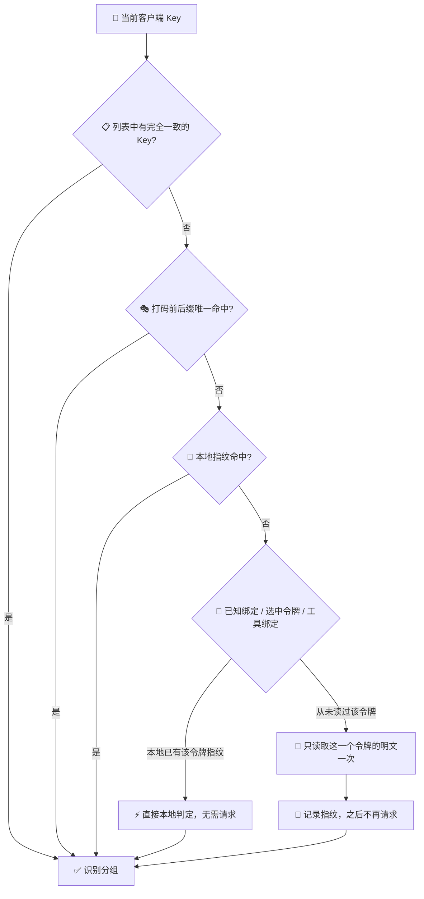

# AI Helper v1.0.79 ⚡🗃️🔐🚀
>
> 📅 **发布日期**：2026 年 11 月 9 日 🍁🗓️  
> 🏷️ **版本代号**：本地优先 · 轻量请求 🪶📉🌿  
> 🎯 **核心关键词**：本地账号缓存、明文 Key 加密落盘、Key 指纹本地比对、打码 Key 前后缀匹配、共享请求缓存、后台暂停轮询 🧠🔑🧬🛰️💤

---

## 🌟 更新速览：同样的功能，少得多的请求 📉✨

v1.0.79 是一次**专注于“减负”**的更新 🪶。在 v1.0.78 加入 HTTP 429 限流防护之后，这一版直接从源头减少对 Bob API 的重复请求，尤其是会进入审计并计入限流的明文 Key 读取接口 `POST /api/token/:id/key` 🔍🚦。

登录有效期间，令牌列表、明文 Key 和价格表都优先从本地读取 💾，**重启应用也不必重新拉取**；首页分组识别尽量在本地完成，只有确实无法判断时才发一次网络请求 🎯。

- 🗃️ **本地账号缓存**：令牌列表、明文 Key、价格表随登录状态持久保存，每天回源校验一次
- 🔐 **明文 Key 加密落盘**：使用 Windows DPAPI / 系统钥匙串加密，令牌列表只保存元数据与打码 Key
- 🧬 **Key 指纹本地比对**：读过一次明文后只记录 SHA-256 指纹，之后启动、切页都在本地比对
- 🎭 **打码 Key 前后缀匹配**：直接用列表返回的 `abcd****wxyz` 识别分组，无需读取明文
- ⏱️ **共享请求缓存**：分组监控、价格表、令牌列表在多个面板之间共享，同一时间段只回源一次
- 💤 **窗口隐藏时暂停轮询**：最小化或切到后台时，分组监控不再持续请求
- 🔄 **手动刷新始终拉最新数据**：令牌选择窗口的“刷新”会跳过所有缓存，直接从服务端获取
- 🧹 **退出即清空**：退出登录、会话失效、切换账号时，本地账号缓存与 Key 指纹一并删除
- 🌐 **全平台发布同步**：桌面端、官网、诊断页、下载入口统一升级至 `v1.0.79`

---

## 🗃️ 本地账号缓存：登录期间“记得住”，退出之后“不留痕” 💾🧹

新增后端模块 `account_cache` 🆕，把 Bob API 的账号数据持久保存在本地 `account_cache.json` 中，生命周期与登录状态严格绑定 🔗。

### 📦 缓存内容与策略

| 数据 🧩 | 本地保存方式 💾 | 回源时机 🔄 |
| :--- | :--- | :--- |
| 📋 令牌列表 | 只保存元数据与**打码 Key** | 每天回源一次；新建、改分组、改状态、删除后立即失效 |
| 🔑 明文 Key | 经 **DPAPI / 系统钥匙串加密**后保存 | 同一令牌 ID 的明文不会变化，登录期间不再重复读取 |
| 💰 价格表与分组倍率 | 原样保存 | 每天回源一次 |

> 💡 如果服务端的列表接口意外返回了明文 Key，AI Helper **绝不以明文落盘** 🙅‍♂️，只保存打码或空值。

### 🔒 生命周期：严格跟着登录状态走

- 🚪 **显式登录成功**（包括同账号重新登录）：清空上一次会话的本地数据，不继承旧缓存
- 👋 **退出登录**：整份删除，并同步删除钥匙串中的加密条目 🗝️
- ⌛ **会话失效**（refresh 过期、账号不符）：整份删除
- 🧯 **本地会话无法恢复**：上次会话留下的账号数据一律作废
- 👤 **读取时核对用户 ID**：任何不一致都视为失效并删除，另一个账号永远读不到上一个账号的数据
- 🧨 **格式无效或版本不符**：直接丢弃并删除文件
- 🔓 **加密条目无法解密**：丢弃该条目，下次回源重新读取

### 🧬 并发与一致性保障

- 🔢 引入**缓存修订号**：每次失效或清空都会递增，回源请求只有在期间没有发生失效时才写回，旧响应不会覆盖新状态 🛡️
- 🔐 写入前在同一次加锁内校验**会话代际与用户 ID**，退出或换号后，旧请求的响应不会重新落盘
- ⚛️ 使用原子写入，进程中断也不会留下半个文件
- 🌐 本地缓存命中时**不刷新 access token、不发任何网络请求**，会话是否仍被服务端接受由启动时的会话恢复与 401 处理负责

---

## 🧬 Key 指纹与打码匹配：首页分组识别几乎零请求 🎯🏷️

首页 Agent 卡片需要知道“当前 Key 属于哪个分组” 🤔。以前确认这件事往往要读取一次明文 Key；现在按以下顺序**优先在本地完成**：

### 🎭 打码 Key 前后缀匹配

- 🔍 解析列表返回的打码 Key（如 `abcd**********wxyz`），用可见的前缀和后缀与本地明文比对
- 📏 可见字符**至少 6 个**才会参与比对，防止过短的片段误匹配
- 🎯 **只有唯一命中才采用**：多个令牌都能匹配时直接放弃，绝不把 Key 误归到另一个令牌 🙅
- 🚫 两个打码 Key 之间不做比对，必须有一侧是明文

### 🧬 明文 Key 指纹

- 🔐 读过一次明文后，只在本地记录「令牌 ID → SHA-256 指纹」，**只保存不可逆的哈希，不保存明文** 🕶️
- 🧂 指纹计算带有固定域前缀，与其他用途的哈希互不混淆
- 📦 最多保留 `64` 条，超出时淘汰最早的记录
- ⚡ 本地已有某令牌的指纹时，直接给出“是 / 不是”的结论，**不再请求明文接口**
- 🧹 退出登录、会话失效或切换账号时自动清除

> 💡 效果：同一个令牌的明文 Key 在登录期间通常**只会被读取一次** 1️⃣，之后的启动、切页、窗口重新聚焦都在本地完成 🏠✨。

---

## ⏱️ 共享请求缓存：多个面板，一次回源 🛰️🤝

每个工具页都挂着一个分组监控面板，而首页卡片、令牌选择窗口也会读取令牌列表 📋。同时挂载或来回切页时，以前容易一次发出多份相同的请求。现在：

| 请求 📡 | 内存缓存时长 ⏳ | 说明 💬 |
| :--- | :--- | :--- |
| 📊 分组监控概览 | `60 秒` | 前端每 90 秒轮询一次，多个面板共享同一份结果，并发请求只回源一次 |
| 📋 令牌列表 | `60 秒`（原 20 秒） | 变更操作会主动失效，无需频繁回源 |
| 🔑 明文 Key | `30 分钟`（原 60 秒） | 同一令牌 ID 的明文不变，会话内长期复用 |
| 💰 价格表与分组倍率 | `5 分钟` | 变化很慢，短时复用 |

### 🎯 更精细的失效策略

- ✂️ 改分组、改状态、新建令牌时**只清令牌列表缓存**，保留明文缓存，一键配置后不必再次读取明文 Key
- 🗑️ 删除令牌时，同步移除该令牌的本地明文条目
- 🧭 读取明文失败（令牌可能已在网页端删除或停用）时，让下一次列表读取回源纠正；**限流错误除外**，避免把 429 误判为令牌失效
- 🚀 一键配置拿到的令牌列表和明文 Key 同样写入本地缓存，之后启动无需再次请求

---

## 💤 后台不打扰：窗口隐藏时暂停轮询 🌙

- 🪟 窗口**最小化或隐藏**时，分组监控面板跳过本轮轮询，不再在后台持续请求 Bob API
- 👀 窗口重新可见后按原有节奏继续刷新，数据照常更新
- 🔋 减少无意义的网络请求，也更省电、更省流量

---

## 🔄 手动刷新：想要最新数据，随时可以 🖱️✨

后端 `get_user_tokens` 新增 `force` 参数 🆕：

- 📂 **打开令牌选择窗口**：优先读取本地缓存，秒开不等待 ⚡
- 🔁 **点击刷新 / 重新加载**：`force = true`，跳过本地缓存和内存缓存，直接从服务端获取 📡
- 🧾 **令牌变更后的内部确认**（创建、确保令牌存在等流程）：同样强制回源，确保拿到真实最新状态
- 🌐 在网页端修改了令牌？点一下刷新即可同步；即使不刷新，每天也会自动回源校验一次 📅

---

## 🧪 回归测试与质量保障 🔬✅

前端安全测试脚本新增多组场景，重点验证“少请求”不以牺牲正确性为代价 🎯：

- ✅ 列表返回打码 Key 时，在本地完成分组匹配，**明文读取次数为 0**
- ✅ 打码 Key 同时匹配多个令牌时拒绝识别，避免误归属
- ✅ 打码比对要求足够的可见字符，过短或前后缀不符时不匹配
- ✅ 明文 Key 只读取一次，之后从本地指纹识别分组，读取次数保持为 `1`
- ✅ 本地指纹已证明是另一个 Key 时，跳过明文读取并清除过期绑定
- ✅ 同一账号登录期间指纹持续有效；切换账号或退出登录时清除
- ✅ 打开令牌窗口读取本地缓存，只有手动刷新才强制回源
- ✅ 本地账号缓存在账号不符时整份失效

---

## 🌐 官网、诊断页与下载渠道统一升级 📦🪟🍎

发布元数据全部切换到 `v1.0.79` 🔄🌍：

- 🖥️ npm / 前端版本升级至 `1.0.79`
- 🦀 Rust / Tauri 包版本升级至 `1.0.79`
- 🌐 官网版本徽标、结构化数据、资源缓存参数更新至 `v1.0.79`
- 🩺 在线诊断核心与诊断页资源版本更新至 `1.0.79`
- 🪟 Windows x64 安装包与便携版链接切换至 `v1.0.79`
- 🍎 macOS Apple Silicon 与 Intel DMG 链接切换至 `v1.0.79`
- ☁️ 本站直链、阿里云 OSS、国内加速镜像与 GitHub Release 链路同步

### 📥 下载文件名

| 平台 💻 | 文件 📦 | 形式 🧰 |
| :--- | :--- | :--- |
| 🪟 Windows x64 | `AI-Helper-v1.0.79-Windows-x64-Setup.exe` | NSIS 安装包 |
| 🪟 Windows x64 | `AI-Helper-v1.0.79-Windows-x64-Standalone.zip` | 免安装便携版 |
| 🍎 macOS Apple Silicon | `AI-Helper-v1.0.79-macOS-aarch64.dmg` | 原生 DMG |
| 🍎 macOS Intel | `AI-Helper-v1.0.79-macOS-x64.dmg` | 原生 DMG |

---

## 🔄 升级指南与使用建议 💡🚀

1. 📥 **安装 v1.0.79**：建议完全退出旧版 AI Helper（包括系统托盘）后再安装。
2. 🔐 **首次启动后正常登录即可**：新登录会建立全新的本地缓存，不会继承旧数据。
3. 🐢 **第一次识别分组可能会请求一次**：每个令牌的明文 Key 首次确认后，之后都在本地完成 ⚡。
4. 🌐 **在网页端改了令牌？** 在令牌选择窗口点击刷新即可立即同步；不刷新的话，每天也会自动校验一次 📅。
5. 🧹 **换账号无需手动清理**：切换账号或退出登录时，本地缓存与指纹会自动删除。
6. 🚦 **遇到 429 限流**：按提示的秒数等待后再试，本版本已大幅减少触发限流的可能 🙏。
7. 🔍 **遇到问题先核对版本**：客户端、官网和诊断页应显示 `v1.0.79`。
8. 📮 **问题反馈**：可通过应用内「意见反馈」提交日志，或前往 [GitHub Issues](https://github.com/TF49/AI-Helper/issues) 交流 💬🙌。

---

## ❓ 常见问题 FAQ 🧭💬

### 本地保存明文 Key 安全吗？ 🔐

明文 Key 只有在经过系统级凭据保护（Windows DPAPI / macOS Keychain / Linux Secret Service）加密后才会写入文件；令牌列表只保存打码 Key；前端只保存不可逆的 SHA-256 指纹 🛡️。退出登录时，缓存文件与钥匙串条目会一并删除 🧹。

### 网页端删除了令牌，AI Helper 还会显示吗？ 🗑️

可能会在缓存有效期内继续显示。点击令牌窗口的刷新即可立即同步；如果读取该令牌明文失败，AI Helper 也会自动让下一次列表读取回源纠正 🔄。

### 为什么首页分组显示“未识别”？ 🏷️

打码 Key 匹配到多个令牌、或可见字符太少时，AI Helper 会选择“不识别”而不是“猜一个” 🎯。这种情况下会退回到读取对应令牌明文的方式确认，通常只需一次。

### 窗口最小化后分组监控还会更新吗？ 💤

窗口隐藏期间暂停轮询；重新打开窗口后会按原有节奏继续刷新 👀。

---

## 🎉 致谢与展望 💙🌟

感谢每一位反馈“频繁触发限流”“首页加载慢”“切页又重新请求”的用户 🙏🧩。v1.0.79 让 AI Helper 更懂得**节制** 🪶：能在本地判断的就不联网 🏠，联网时也只问一次 1️⃣，而你的 Key 始终被**加密保护** 🔐、**用完即清** 🧹。

愿每一次启动都更快、每一次请求都必要、每一席 Agent 都轻装上阵 🤖✨🎊！
