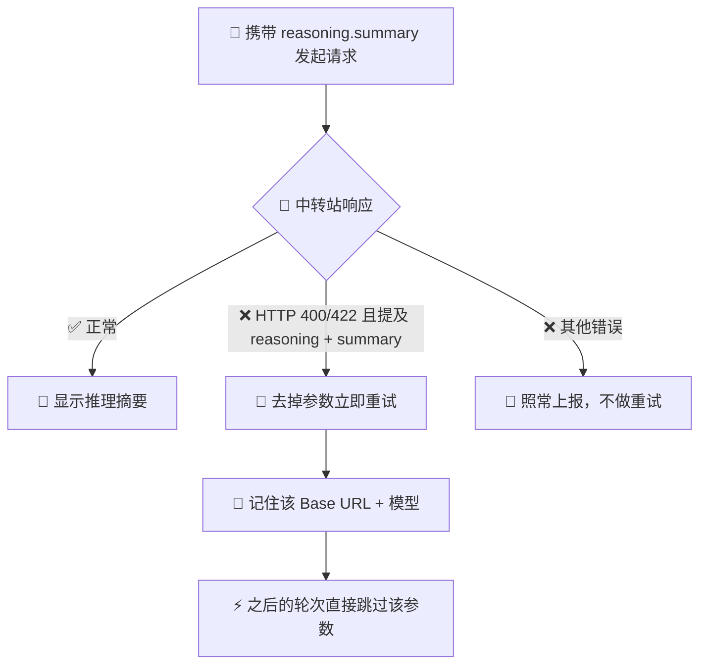

# AI Helper v1.0.80 🧠💭✨🚀
>
> 📅 **发布日期**：2026 年 11 月 11 日 🍂🗓️  
> 🏷️ **版本代号**：看见思考 · Cursor 推理摘要上线 💡🖱️📝  
> 🎯 **核心关键词**：Reasoning Summary、思考区块、中转站自动降级、OpenRouter 兼容、Markdown 分段、工具提示净化 🧩🔁🌐📐🧼

---

## 🌟 更新速览：Cursor 的“思考中”终于有内容了 💭➡️📖

在 v1.0.80 之前，通过 AI Helper Bridge 使用推理模型时，Cursor 的**思考区块（Thinking Block）里几乎只有“正在执行 xxx”这样的工具提示** 🛠️，看不到模型究竟在想什么 🤔。

原因是：推理模型只会在**被明确要求时**才返回推理摘要，而此前 Bridge 发出的 Responses 请求从未提出这一要求 📭。

v1.0.80 补上了这块拼图 🧩：

- 🧠 **主动请求推理摘要**：Responses 请求自动携带 `reasoning.summary = "auto"`
- 🔁 **中转站不支持时自动降级**：被拒绝后立即去掉该参数重试，并**记住**这个中转站 + 模型组合，之后不再重复失败请求
- 🎯 **精准识别拒绝**：只有 HTTP `400 / 422` 且明确指向 summary 参数的错误才视为“不支持”，其他推理错误照常上报
- 🌐 **兼容更多中转站**：Chat Completions 流同时识别 DeepSeek 风格的 `reasoning_content` 与 OpenRouter / vLLM 风格的 `reasoning`
- 📐 **Markdown 分段更清晰**：每段摘要、每条工具提示都是独立段落，不再挤成一行
- 📦 **兜底读取最终摘要**：中转站没有流式推送摘要时，从 `response.completed` 中补读
- 🧼 **工具提示更干净**：工具名去除反引号并用代码样式显示，空名称显示为“未命名工具”
- 🌐 **全平台发布同步**：桌面端、官网、诊断页、下载入口统一升级至 `v1.0.80`

---

## 🧠 推理摘要：让思考过程“看得见” 👀💡

### 📨 请求侧：明确告诉模型“请把思路讲出来”

通过 Responses 协议调用模型时，Bridge 现在会在请求中加入：

```json
{
  "reasoning": { "summary": "auto" }
}
```

推理模型收到后，会把思考过程的**摘要**以流式事件推送回来 📡，AI Helper 再实时转发到 Cursor 的思考区块中 🖱️✨。

### 🎬 效果对比

| 场景 🎭 | v1.0.79 及之前 ⏪ | v1.0.80 ✅ |
| :--- | :--- | :--- |
| 🧠 推理模型分析问题 | 思考区块空白，或只有一句“模型正在分析工具结果” | 显示模型的分步推理摘要 |
| 🛠️ 调用工具 | `正在执行 read_file` 与上一句话粘在一起 | 独立成段：``正在执行 `read_file` `` |
| 📦 中转站不流式推送摘要 | 什么都看不到 | 从最终结果中补读并显示 |
| 🤐 模型有推理但没有摘要 | “模型正在分析工具结果” | 中性占位：“模型正在思考” |

### 🧾 一个典型的思考区块现在长这样

```markdown
**Inspecting file**

Need to read hello.txt

正在执行 `read_file`
```

每段摘要、每条工具提示之间都有空行分隔 📏，Cursor 会按 Markdown 正确渲染粗体标题与段落 🎨。

---

## 🔁 中转站兼容：不支持也不会“卡住” 🛡️🌉

并不是每个中转站都认识 `reasoning.summary` 参数 🤷。有的会忽略它，有的会直接返回错误 ❌。v1.0.80 对后者做了**自动降级 + 记忆**：



### 🎯 精准判断，不误伤

- ✅ `400 Unsupported parameter: 'reasoning.summary'` → 判定为不支持，自动降级
- ✅ `422 unknown field 'summary' in 'reasoning'` → 判定为不支持，自动降级
- 🚫 `400 Item of type 'reasoning' was provided without its required following item` → **不是** summary 问题，照常报错，便于排查
- 🚫 `500 reasoning summary failed` → 服务端故障，不触发降级

### 🧠 记忆规则

- 🔑 以 **Base URL + 模型名** 作为标识，不同中转站、不同模型互不影响
- ⏳ 记忆在 AI Helper 运行期间有效，同一会话的后续轮次不再发出注定失败的请求 ⚡
- 🔄 重启 AI Helper 后会重新尝试；如果中转站已经升级支持，摘要会自动恢复显示 🎉
- 📝 降级时写入一条警告日志，方便确认是哪个中转站不支持

---

## 🌐 Chat Completions：兼容两种推理字段 🤝

不同中转站在 Chat Completions 流中返回推理内容的字段名并不统一 🔀：

| 风格 🏷️ | 字段名 🧩 | 常见来源 🌍 |
| :--- | :--- | :--- |
| 🐋 DeepSeek 风格 | `reasoning_content` | DeepSeek 及兼容中转站 |
| 🔀 OpenRouter / vLLM 风格 | `reasoning` | OpenRouter、vLLM 部署等 |

v1.0.80 会**依次检查这两个字段**，取第一个非空值显示在思考区块中 💭。流式与非流式响应都适用 ✅。

---

## 📐 思考区块排版优化 🎨📝

- 📏 **摘要分段**：每收到一个 `reasoning_summary_part.done` 或 `reasoning_text.done` 事件，就为该段落补上段落分隔
- 🕳️ **跳过空段落**：空的摘要片段不会产生多余的空行
- 🔂 **不重复显示**：已经流式显示过的摘要，不会在结束事件中再显示一遍
- 🛠️ **工具提示独立成段**：前后都有空行，不会和上一句推理粘在一起
- 🧼 **工具名净化**：去除反引号后用代码样式包裹，防止破坏 Markdown 渲染；空名称显示为“正在执行未命名工具”
- 🔀 **协议切换提示**：“中转站未提供 Responses 端点，使用 Chat Completions 工具协议”同样独立成段

---

## 🧪 回归测试与质量保障 🔬✅

本次为 Cursor Agent 新增了一组模拟中转站的端到端测试 🧪🌉：

- ✅ Responses 请求携带 `reasoning.summary = "auto"`
- ✅ 摘要片段与工具提示保持为独立的 Markdown 段落
- ✅ 中转站拒绝 summary 参数时自动去掉重试，第二轮直接跳过（共 3 次请求而不是 4 次）
- ✅ 其他推理相关错误照常上报，不触发重试，也不会被误记为“不支持”
- ✅ 空摘要片段被跳过；已流式显示的摘要不会重复
- ✅ 中转站只在最终结果中返回摘要时也能正确显示
- ✅ 只有 400 / 422 且同时提及 reasoning 与 summary 的错误才判定为不支持
- ✅ 工具提示正确净化反引号，空名称显示占位文字
- ✅ Chat Completions 流能识别 OpenRouter 风格的 `reasoning` 字段

---

## 📚 文档整理 🗂️

- 🧹 移除已归档的内部安全收尾文档
- 📋 更新内部安全任务追踪记录

---

## 🌐 官网、诊断页与下载渠道统一升级 📦🪟🍎

发布元数据全部切换到 `v1.0.80` 🔄🌍：

- 🖥️ npm / 前端版本升级至 `1.0.80`
- 🦀 Rust / Tauri 包版本升级至 `1.0.80`
- 🌐 官网版本徽标、结构化数据、资源缓存参数更新至 `v1.0.80`
- 🩺 在线诊断核心与诊断页资源版本更新至 `1.0.80`
- 🪟 Windows x64 安装包与便携版链接切换至 `v1.0.80`
- 🍎 macOS Apple Silicon 与 Intel DMG 链接切换至 `v1.0.80`
- ☁️ 本站直链、阿里云 OSS、国内加速镜像与 GitHub Release 链路同步
- 🗺️ 官网 sitemap 的最后更新时间更新为 `2026-11-11`

### 📥 下载文件名

| 平台 💻 | 文件 📦 | 形式 🧰 |
| :--- | :--- | :--- |
| 🪟 Windows x64 | `AI-Helper-v1.0.80-Windows-x64-Setup.exe` | NSIS 安装包 |
| 🪟 Windows x64 | `AI-Helper-v1.0.80-Windows-x64-Standalone.zip` | 免安装便携版 |
| 🍎 macOS Apple Silicon | `AI-Helper-v1.0.80-macOS-aarch64.dmg` | 原生 DMG |
| 🍎 macOS Intel | `AI-Helper-v1.0.80-macOS-x64.dmg` | 原生 DMG |

---

## 🔄 升级指南与使用建议 💡🚀

1. 📥 **安装 v1.0.80**：建议完全退出旧版 AI Helper（包括系统托盘）后再安装，确保 Cursor Bridge 使用新逻辑。
2. 🖱️ **重启 Cursor**：让 Cursor 重新连接到新版 Bridge。
3. 🧠 **选择推理模型体验**：使用支持推理的模型时，展开 Cursor 的思考区块即可看到分步推理摘要 💭。
4. 🤷 **思考区块仍然只有工具提示？** 说明当前中转站或模型不提供推理摘要，AI Helper 已自动降级，**不影响正常对话和工具调用** ✅。
5. 🔄 **中转站升级后**：重启 AI Helper 即可重新尝试请求推理摘要。
6. 🔍 **遇到问题先核对版本**：客户端、官网和诊断页应显示 `v1.0.80`。
7. 📮 **问题反馈**：可通过应用内「意见反馈」提交日志，或前往 [GitHub Issues](https://github.com/TF49/AI-Helper/issues) 交流 💬🙌。

---

## ❓ 常见问题 FAQ 🧭💬

### 为什么我的思考区块还是没有推理内容？ 🤔

可能有以下原因：所用模型不是推理模型 🧩；中转站不支持 `reasoning.summary` 参数，已被自动降级 🔁；或中转站不转发推理摘要 📭。这些情况都不影响模型的回答质量和工具调用。

### 推理摘要是模型完整的思考过程吗？ 💭

不是。推理模型只对外提供**摘要**，而不是完整的内部推理 📝。摘要已经足以帮你了解模型的分析思路和下一步打算 🧭。

### 中转站报错后会不会一直重试？ 🔁

不会。每个“中转站 + 模型”组合最多只会失败一次，之后在 AI Helper 运行期间都直接跳过该参数 ⚡。

### 显示推理摘要会多消耗额度吗？ 💰

推理摘要由模型在推理过程中顺带生成，具体是否计费以及如何计费取决于上游服务商和中转站的规则 📊。

---

## 🎉 致谢与展望 💙🌟

感谢反馈“Cursor 思考区块里只有工具提示”的用户 🙏🧩。v1.0.80 让 AI Helper 接入的推理模型在 Cursor 中**不再沉默** 🗣️：你能看到它怎么想 💭、准备做什么 🛠️，遇到不支持的中转站也能**悄悄绕过、绝不卡住** 🛡️。

愿每一次思考都清晰可见、每一个中转站都畅通无阻、每一席 Agent 都更值得信赖 🤖✨🎊！
