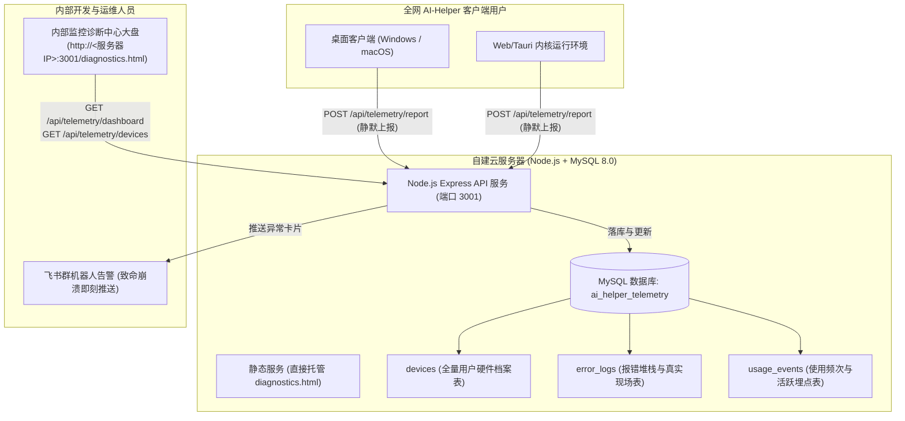

# AI-Helper 内部开发者全量监控与诊断服务端部署指南

本项目是专为 **AI-Helper 内部开发与运维团队** 配套打造的全量监控与故障诊断后端服务（Node.js Express + MySQL 8.0 架构），支持部署到您自己的 Linux / Windows 云服务器上。

---

## 一、核心定位与真实性保障

1. **服务对象**：仅限内部开发与运维人员使用（内部专用，严禁对外公开发布）。
2. **核心目标**：
   - **使用情况与频次统计**：全网真实设备总数、今日活跃用户数 (DAU)、今日/累计调用总量、过去 7 天使用频率走势图、今日 24 小时峰值时段。
   - **真实机器硬件配置档案库**：全量沉淀所有用户的真实操作系统、CPU 逻辑核心、GPU 显卡渲染器硬件型号、内存大小、屏幕分辨率与客户端软件版本，支持按设备 ID 深入追查单机档案。
   - **真实报错原因与调用栈诊断**：捕获所有用户的 JS 运行时崩溃、异步 Promise 拒绝等异常，落库完整调用栈（Stack Trace）、**崩溃发生时该用户的真实硬件环境快照**、以及**崩溃前用户的行为操作轨迹 (Breadcrumbs)**。
3. **真实性原则**：
   - **100% 拒绝任何虚拟假数据与随机数**。
   - 所有指标均严格由 MySQL 表（或开发内存暂存）按真实上报数据计算聚合。若某日调用为 0，大盘诚实显示 0，绝不捏造。

---

## 二、系统全景架构



---

## 三、部署方式一：Docker Compose 一键部署（最推荐）

如果您的服务器已安装 Docker 和 Docker Compose，只需 1 步即可启动 MySQL 8.0 与监控 API：

1. 将 `server/` 和 `website/` 目录上传到服务器同一父级目录下（例如 `/opt/ai-helper/`）。
2. 进入 `server/` 目录执行：
   ```bash
   docker compose up -d
   ```
3. 服务将自动创建 MySQL 数据库并在 `http://<您的服务器IP>:3001` 启动。
4. 内部开发人员可直接在浏览器中访问：
   ```
   http://<您的服务器IP>:3001/diagnostics.html
   ```

---

## 四、部署方式二：原生 Linux 服务器部署 (PM2 + MySQL)

### 1. 安装与初始化 MySQL
登录服务器 MySQL 执行建表脚本（服务启动时亦会自动执行安全建表）：
```bash
mysql -u root -p < schema.sql
```

脚本将自动创建 `ai_helper_telemetry` 数据库及 3 张核心表：
- `devices`：终端用户设备与硬件信息表
- `error_logs`：全局用户异常与报错追踪日志表（含堆栈、崩溃环境快照与操作轨迹）
- `usage_events`：使用频次与活跃度明细表（DAU、心跳、启动打点）

### 2. 配置环境变量
在 `server/` 目录下复制配置模板并修改：
```bash
cp .env.example .env
vim .env
```
填入您的真实 MySQL 密码：
```ini
PORT=3001
DB_HOST=127.0.0.1
DB_PORT=3306
DB_USER=root
DB_PASSWORD=您的真实MySQL密码
DB_NAME=ai_helper_telemetry
DB_CONNECTION_LIMIT=10
CORS_ORIGIN=*
```

### 3. 安装依赖与启动服务
```bash
cd server
npm install

# 使用 PM2 守护进程常驻后台运行
npm install -g pm2
pm2 start server.js --name "ai-helper-telemetry"
pm2 save
pm2 startup
```

---

## 五、开发者使用与客户端连接

1. **访问开发者监控中心**：
   - 直接访问：`http://<您的服务器IP>:3001/diagnostics.html`。
   - 顶部状态点应显示：`🟢 MySQL 已连接 (Host: 127.0.0.1, 累计 N 台设备)`。
2. **大盘三大核心视图**：
   - **📊 监控分析大盘**：实时查看累计设备、DAU、今日频次、7天真实使用走势、24小时峰值、操作系统与版本分布。
   - **💻 真实用户设备档案库**：搜索全网任意用户的设备 ID，点击 **「🔍 诊断」** 即可查阅该用户的详细硬件配置、显卡驱动、屏幕分辨率、该设备发生过的所有历史报错。
   - **🐞 异常追踪与日志流**：点击任意报错的 **「排查」** 按钮，可查看完整调用栈、**发生崩溃时该用户的机器硬件快照**、以及崩溃前的 25 条操作轨迹。
3. **客户端上报配置**：
   - 客户端 SDK 位于 `src/lib/clientTelemetry.ts`，默认指向 `http://localhost:3001/api/telemetry/report`。
   - 线上发布时，客户端会自动读取 localStorage `ai_helper_telemetry_server_url` 或在 `main.tsx` 中初始化指向您的公网服务器地址。
